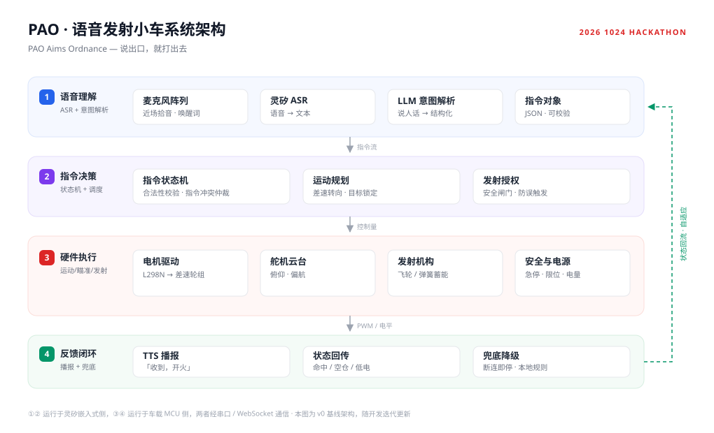

<div align="center">


# PAO

**PAO Aims Ordnance**

一台听得懂人话、会开火的小车

<sub>2026 1024 Hackathon · 智能硬件赛道</sub>

</div>

---

> ### PAO = PAO Aims Ordnance
>
> 这是一个**递归缩写**（recursive acronym）：全称的第一个词，就是缩写本身。
> 和 `GNU's Not Unix`、`YAML Ain't Markup Language`、`WINE Is Not an Emulator` 一样，
> 它的定义永远指回自己。说不清，也都说得清。

---

## 它是什么

对着它说话，它会听懂、会开过去、会瞄准、会开火，然后告诉你打中了。

不需要摇杆，不需要 App，不需要记指令表。**说出口，就打出去。**

| 能力 | 说明 |
|---|---|
| **说人话就能开** | 一句话完成「前进 / 转向 / 瞄准 / 发射」，不用记快捷键 |
| **会回报** | 每次动作有 TTS 播报和状态回传，不是单向的哑巴机器 |
| **有安全闸门** | 发射需要显式授权，断连即停，不靠运气 |

## 系统架构



从「说出口」到「打出去」，中间要穿过四层：

| 层 | 职责 | 运行侧 |
|---|---|---|
| ① 语音理解 | 麦克风拾音 → 灵矽 ASR → LLM 意图解析 → 结构化指令 | 灵矽 |
| ② 指令决策 | 指令状态机、运动规划、发射授权（安全闸门） | 灵矽 |
| ③ 硬件执行 | 电机驱动、舵机云台、发射机构、安全与电源 | 车载 MCU |
| ④ 反馈闭环 | TTS 播报、状态回传、断连兜底 | 车载 MCU |

关键点在于 **② 和 ③ 的边界**：语音侧只下发「意图」，不碰 PWM 占空比；MCU 侧只执行「指令」，不理解语言。这条边界让两侧可以独立开发、独立替换。

## 目录结构

```
.
├── docs/            架构图、图标
├── voice/           灵矽侧语音链路（ASR → 意图 → 指令）
├── firmware/        车载 MCU 固件（运动 / 云台 / 发射）
├── server/          指令总线与状态同步
└── hardware/        结构件、电路、物料清单
```

> `voice/` `firmware/` `server/` `hardware/` 尚在建设中，目录随开发推进落位。

## 快速开始

🚧 施工中 —— 硬件组装、固件烧录与语音侧启动步骤将随首个可运行版本补齐。

## 协作规范

- **所有变更走 PR**，`main` 不接受直接 push。
- 每个 PR 一件事，提交信息用 `feat:` / `fix:` / `docs:` / `chore:` 前缀。
- 若引入外部 codebase，必须在**团队写入第一行代码之前**打 `v0` tag。
- Issue 按 `hardware` / `voice` / `firmware` / `docs` 打标签，方便分工认领。

## 路线图

| 阶段 | 目标 |
|---|---|
| Day 1 | 车体走通、语音链路打穿、单条指令端到端联调 |
| Day 2 | 云台瞄准 + 发射机构接入、多指令会话、状态回传 |
| Day 3 | 稳定性与安全兜底、演示脚本、架构文档与 demo 视频 |

## 关于这个名字

我们本来想叫它「嘴炮」—— 嘴上说说，炮弹就打出去了。后来发现「炮」的拼音 `PAO` 刚好能凑成一个递归缩写，就再没改过。

---

<div align="center">
<sub>Talk is cheap. We shoot anyway.</sub>
</div>
