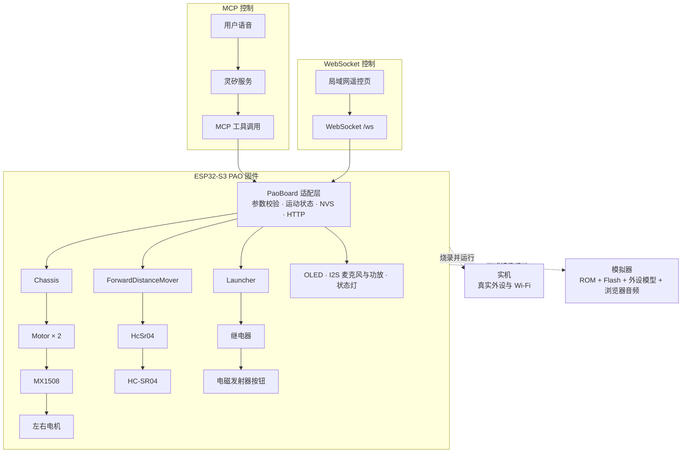

<a name="ai-start"></a>

复制下面的提示词给能操作终端的 AI：

```arduino
请克隆或复用 https://github.com/pao-1024/pao，按 AGENTS.md 和 simulator/README.md 准备依赖。
在仓库根目录运行 task simulator:prepare，再运行 task simulator:run，保持服务运行并保留设备状态。
确认固件、模拟器和遥控页正常后，给我访问地址与停止方法；需要设备激活或麦克风授权时提示我。
```

# PAO

> # PAO = PAO Aims Ordnance
>
> 这是一个**递归缩写**（recursive acronym）：全称的第一个词，就是缩写本身。和 `GNU's Not Unix`、`YAML Ain't Markup Language`、`WINE Is Not an Emulator` 一样，它的定义永远指回自己。说不清，也都说得清。

<div align="center">


一台听得懂人话、会开火的小车

<sub>2026 1024 Hackathon · 智能硬件赛道</sub>

<p>
  <a href="docs/making-of.md#演示视频"></a>
  <a href="https://github.com/user-attachments/assets/b82adcdc-420b-4e07-abb6-0e4ae3ad228b"></a>
  <a href="#ai-start"></a>
</p>

<p>
  <a href="hardware/README.md"></a>
  <a href="firmware/README.md"></a>
  <a href="firmware/README.md"></a>
  <a href="simulator/README.md"></a>
  <a href="experimental/platform/README.md"></a>
  <a href="experimental/platform/README.md"></a>
  <a href="hardware/README.md"></a>
</p>

</div>

---

## 它是什么

不需要摇杆，不需要 App，不需要记指令表。**说出口，就打出去。**

## 实车演示

[](docs/making-of.md#演示视频)

观看[实车演示视频](docs/making-of.md#演示视频)，包含语音控制、遥控控制和发射测试。完整装配记录见[PAO 制作过程](docs/making-of.md)。

## 系统组成

设备有两条并列控制入口：灵矽服务通过 MCP 调用设备工具，局域网遥控页通过 WebSocket 下发 JSON。两条路径最终汇合到 `PaoBoard`，再进入底盘、测距、发射和外设模块。



## 团队与分工

| 成员 | 分工 |
| --- | --- |
| Zhiqiang Zhang（[@zhangzqs](https://github.com/zhangzqs)） | 硬件设计与组装，底盘、测距及发射驱动，板级集成，固件 CI。 |
| jimyag（[@jimyag](https://github.com/jimyag)） | 构建流程，模拟器内核与界面，语音工具与网页遥控，联调验收。 |

## 功能

- **语音控制**：唤醒词“小炮小炮”；可查询前方距离、前进指定厘米数、前后移动、原地转向、停车、开炮、查询设备 IP 和结束对话。
- **双模式遥控**：联网后打开设备 IP 对应页面，可用方向按钮或 WASD 驾驶；支持输出上限、左右轮比例、实时测距和开炮。
- **安全停车**：方向指令带有效期，网页失焦、关闭或断网后不续发；支持立即停止和按距离运动的超时、测距失败停车。
- **状态显示**：SSD1306 OLED 显示设备状态、表情、对话与访问地址；开发板状态灯和扬声器同步反馈。
- **电磁发射**：语音或网页单次触发；继电器按下发射器按钮，同时播放发射音效。
- **硬件即代码**：用 tscircuit 的 TSX 描述供电、ESP32-S3、麦克风、功放、OLED、超声波、电机驱动和发射器接线，并从源码生成原理图。
- **芯片级模拟**：从 ROM 启动正式固件，显示 OLED、引脚状态、I2C、MCPWM、I2S、串口和可跟随的 3D 小车；支持浏览器麦克风和扬声器。

## 硬件即代码 · Hardware as Code

**接线可以 diff，电路可以测试，原理图可以构建。**

PAO 用 [tscircuit](https://tscircuit.com/) 把供电、主控、音频、屏幕和电机驱动写成可组合的 TSX 组件。模块能复用，连线能在 PR 中审查，图纸从源码生成；CI 自动检查 GPIO、电源、输出连接和图纸一致性，让硬件设计也进入 Git、PR 和 CI 的协作流程。

PAO 参考机的模块接线与原理图见 [ESP32-S3 模块接线图与预览说明](hardware/README.md)。

## 固件 · Voice & Motion

**一句话，变成一条设备指令。**

固件基于 ESP-IDF 和小智语音工程，在 ESP32-S3 上完成唤醒词、音频、显示与设备控制。灵矽通过 MCP 调用底盘、测距、电磁发射、网络信息和待机工具；局域网遥控页通过 WebSocket 进入同一套板级控制逻辑。运动参数保存在 NVS，底盘定时停车、测距失败停车和发射继电器脉冲都由设备侧校验与执行。

当前语音角色使用灵矽 AI 智控台，音色、完整提示词和应用步骤见[PAO 语音助手配置](docs/agent.md)。

GPIO、板型、语音工具、局域网遥控、构建方式和实机接入说明见[固件说明](firmware/README.md)。

## 模拟器 · Firmware in the Loop

**同一份正式固件，在浏览器里运行。**

模拟器使用 Rust、esp32sim 和仓库中的 PAO 板型，从芯片 ROM 启动正式固件。页面将固件真实 I2C 写入渲染成 OLED，把 MCPWM 转为可跟随的 3D 小车，把 HC-SR04 回波送进正式 RMT 驱动，并同步显示接线状态、I2C、PWM、I2S、UART 和底盘指令。浏览器麦克风与扬声器可直接进入设备的语音交互链路。

[观看模拟器使用演示](https://github.com/user-attachments/assets/b82adcdc-420b-4e07-abb6-0e4ae3ad228b)：在浏览器里通过语音控制正式固件，并查看 OLED、3D 小车、I2C、PWM、I2S 和日志。

启动、配网、语音验证、底盘验收和模拟器架构见[模拟器说明](simulator/README.md)。

## 没有硬件，也能开始设计与验证

PAO 是一款语音交互小车，也是 PAO Studio 硬件开发平台的首个验证产品。我们用 PAO 验证从需求、模块组合、接线与电路检查，到固件编译、仿真和实物运行的开发流程，让同一套工具能够用于更多智能硬件项目。

PAO Studio 是 Agent 驱动的模块化硬件开发平台。把有真实引脚、驱动和仿真模型的硬件像软件模块一样组合，让 Agent 根据自然语言需求选择模块、自动接线、生成 PCB 与业务固件，并根据检查、编译和仿真中的报错迭代修复。

在实物模块到手之前，可以先检查供电、公共地、复位、负载、引脚和总线地址，并运行编译后的固件；在打板之前，可以检查模块封装、布局、铜线连接和制造规则。已建模范围内的问题可以在软件工作台里复现、观察和修改，减少等待实物与提前可发现的打板返工。

目前实验性工作台已支持内置真实模块的组合、自动接线、原理图与 PCB 制造文件生成、固件编译，以及软件在环（Software-in-the-Loop，SIL）场景验收。当前 PCB 输出是指定模块的安装板；仿真覆盖已建模的数字接口与业务行为，温升、射频、声学、机械负载和实际测量精度仍需实物验证。使用方法和能力范围见 [PAO Studio](experimental/platform/README.md)。

## 未来方向与商业化规划

我们希望把 PAO 验证过的开发流程推广到更多智能硬件项目，服务独立开发者和小型硬件团队。平台的商业价值是帮助团队在采购、组装和打板前发现问题，并复用已经验证的模块、驱动与工程方案。

- 产品规划：扩展真实模块与驱动，建立可复用的设备方案和批量 SIL 回归，让更多项目能在没有实物时开始开发。
- 验证规划：把软件检查与硬件在环（Hardware-in-the-Loop，HIL）、样板装配和实物测量结合，核对模型与真实设备的差异。
- 商业化探索：验证团队协作、托管编译与仿真、私有模块库及工程交付支持的付费需求；这些属于后续方向，当前仍是本地实验性工作台。

产品阶段、商业化假设与验证方式见[硬件开发平台规划](docs/platform-roadmap.md)。

---

<div align="center">
<sub>Talk is cheap. We shoot anyway.</sub>
</div>
