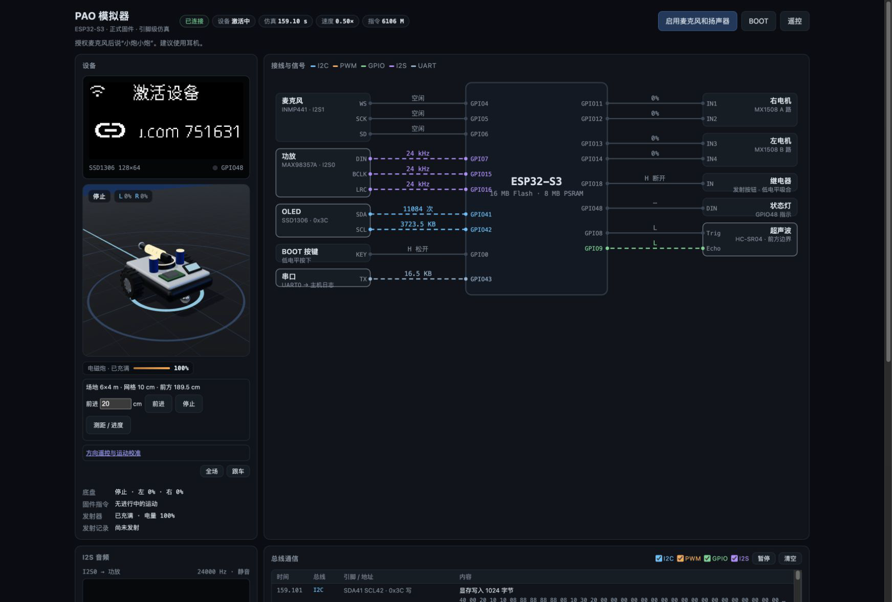
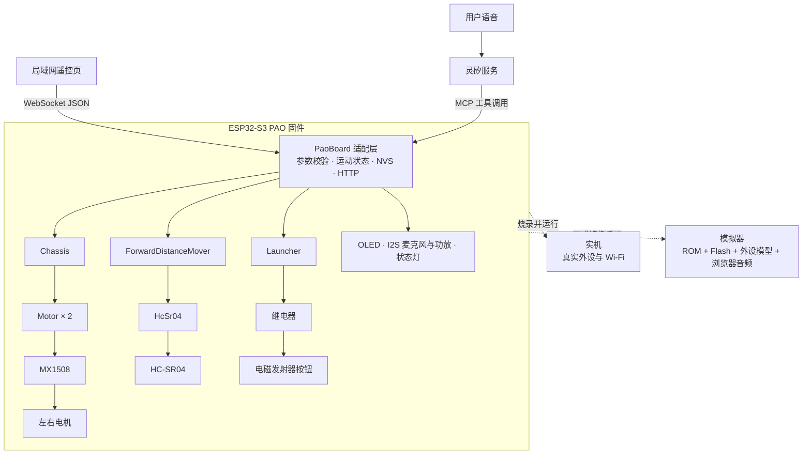
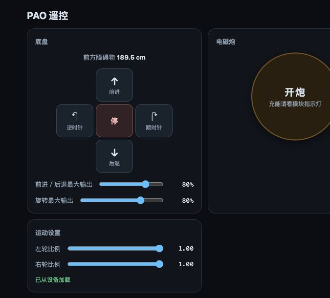

# PAO 架构设计

PAO 是一台可在局域网或仿真环境中通过语音、网页遥控运动与电磁发射的 ESP32-S3 小车。项目采用三层结构：由 TSX 描述模块与接线，由正式 ESP-IDF 固件复用灵矽语音能力并提供底盘、测距与发射控制，由芯片级模拟器运行同一份固件并观测外设总线。产品设计的重点不是增加控制入口，而是让硬件连接、业务固件和交互验证处在同一条可审查的工程链路中。



完整页面的音频与串口区域见[整页截图](images/simulator-overview-full.jpg)。

## 团队与分工

### Zhiqiang Zhang（[@zhangzqs](https://github.com/zhangzqs)）

- 硬件设计：使用 tscircuit 定义电池保护、电源开关、5V 升压、ESP32-S3、麦克风、功放、OLED、HC-SR04、MX1508、发射继电器和发射器接线；统一 44 针开发板引脚、共享网络与电源域，生成原理图并补齐连通性测试。
- 电机与底盘：实现 MX1508 双路电机驱动、左右轮方向适配、前进／后退／原地旋转／立即停止，以及平移和旋转最大输出、左右轮比例和 NVS 持久化；接入网页、WebSocket 和语音底盘控制。
- 电磁发射：完成 HU-064 发射器选型和组装，设计常供电、独立 3.3V 与低电平继电器接线；实现单次 300 ms 发射脉冲，以及上电保持断开和并发调用串行化。
- 距离控制：接入 3.3V 版 HC-SR04，实现 RMT 微秒级回波捕获、60 ms 触发间隔和测距错误处理；实现按前方距离变化前进、10 cm 停止余量、15 秒超时和新指令取消。
- 板级集成：接入 SSD1306 OLED，建立 PAO 板型、GPIO 配置、MCP 工具、遥控页和 WebSocket 控制服务，使网页、语音和驱动共享同一套板级状态与参数校验。
- 工程保障：维护 EIM 构建入口、ccache、固件 CI 和产物上传，补充硬件接线测试与仓库配置检查，保证硬件设计、固件编译和文档能够持续验证。

### jimyag（[@jimyag](https://github.com/jimyag)）

- 工程基础：建立固件目录、小智外部组件接入、Task 构建入口和最小语音板型，把上游源码、构建缓存与仓库业务代码分开管理。
- 模拟器内核：接入固定版本的 esp32sim，从 ROM 启动正式 PAO 固件，模拟 Flash、NVS、Wi-Fi、I2S、RMT、SSD1306 和 GPIO48 状态灯。
- 观测系统：采集固件真实 GPIO、I2C、MCPWM 和 I2S 活动，解析底盘位姿、前方距离、总线事件和 UART0 日志，并通过 WebSocket 推送到浏览器。
- 模拟交互：实现 React/Three.js/Canvas 和 AudioWorklet 页面，显示 OLED、可跟随的 3D 小车、场地轨迹、引脚连线、音频波形和串口日志，支持浏览器麦克风与扬声器。
- 语音与遥控：接入底盘、电磁发射、网络地址和待机 MCP 工具；实现局域网遥控页、方向续发、输出与轮速校准、距离查询、断线停车和新指令替换旧运动。
- 联调验收：打通测距回波、按距离前进、发射音效和 3D 场景，编写底盘三阶段验收脚本，并记录固件、模拟器和实机交互的验证结果。

## 系统组成



### 用户入口

| 入口 | 位置 | 作用 |
| --- | --- | --- |
| 语音 | 唤醒词“小炮小炮” | 经灵矽与设备 MCP 调用底盘、测距、发射、网络信息和待机工具 |
| 局域网遥控页 | `http://<设备 IP>/` | 方向按钮、键盘驾驶、最大输出和左右轮比例校准、测距与发射 |
| 模拟器网页 | `http://127.0.0.1:8080/` | 运行正式固件，显示 OLED、3D 车体、引脚、总线、音频和串口日志 |
| 模拟器内遥控页 | `http://127.0.0.1:8081/` | 访问模拟设备上运行的同一张固件遥控页 |

网页遥控不调用灵矽服务，直接通过设备上的 WebSocket `/ws` 下发 JSON；语音与网页最终进入同一组板级控制方法。

## 硬件模块规格

硬件连接使用 tscircuit 的 TSX 源码维护，模块组合入口是 `hardware/index.tsx`，功能区在 `hardware/sections/`，器件接口在 `hardware/components/`。原理图由源码生成；当前只验证模块外部接线，不代表可生产 PCB。

| 模块 | 实现与电气约束 | 用途 |
| --- | --- | --- |
| 1S 电池、TP4056 充电保护板、三脚开关、MT3608 5V 升压板 | 电池经保护板供电，开关串在保护板 `OUT+` 与升压输入之间；负载只从保护板回流，保护前 `B−` 不并入系统地 | 整机供电与总开关 |
| ESP32-S3 DevKitC-1 | 16 MB Flash、八线 8 MB PSRAM；保留官方 44 个物理引脚 | 主控、Wi-Fi、语音、网页服务 |
| INMP441 | I2S 输入，GPIO4/5/6；16 kHz、左声道 | 语音输入 |
| MAX98357A 与扬声器 | I2S 输出，GPIO7/15/16；24 kHz、左声道、12 dB 增益 | 语音回复与发射音效 |
| SSD1306 OLED | I2C 0x3C，SDA/SCL 接 GPIO41/42，128×64 | 状态、表情、对话和访问地址 |
| HC-SR04（3.3V 版） | Trig/Echo 接 GPIO8/9，RMT 捕获回波 | 前向测距和按距离前进反馈 |
| MX1508 与双轮电机 | IN1–IN4 接 GPIO11–14，MCPWM 1 kHz；右轮为 IN1/IN2，左轮按 IN4/IN3 创建以统一前进方向 | 前进、后退、原地旋转 |
| 3.3V 单路继电器与 HU-064 电磁发射器 | 继电器线圈和发射器使用由 5V 降压得到的独立 3.3V；GPIO18 低电平吸合；触点短接发射器 FIRE 与 GND | 按下发射按钮，放电回路不带过继电器 |
| BOOT 按键、WS2812 | GPIO0 与 GPIO48，均为开发板板载器件 | 启动/配网/对话与状态指示 |

发射器与主控 3V3 只共地、不并电源。发射器上电后持续充能，软件没有断电或充能状态读取能力；每次发射都会真实按下按钮，是否充满需观察模块指示灯并由操作者把握。

## 固件模块规格

| 模块 | 源码位置 | 职责与接口 |
| --- | --- | --- |
| `PaoBoard` | `firmware/boards/pao/pao_board.cc` | 小智板级适配层；创建外设与运动对象、注册 MCP 工具和 HTTP/WebSocket、保存运动配置、协调定时停车和定距运动。 |
| `Motor` | `firmware/components/pao/` | 控制 MX1508 一路电机；输入为 `[-1, 1]` 的归一化占空比，串行保护，非法值停止或限幅。 |
| `Chassis` | 同上 | 将前进、后退、左转、右转、停止转换为左右轮输出；输出量来自 `ChassisConfig`，不是闭环速度。 |
| `HcSr04` | 同上 | 同步测量 2–400 cm；校验 Trig 脉宽、Echo 回波和 RMT 接收，返回明确的 ESP-IDF 错误。 |
| `ForwardDistanceMover` | 同上 | 以前方同一静止反射物的距离变化估算前进量；保留至少 10 cm 余量、最长 15 秒，并在测距失败或新指令时停车。 |
| `Launcher` | 同上 | 将 GPIO18 拉低 300 ms 再释放，串行化并发发射和网页按钮操作。 |
| 板型配置 | `firmware/boards/pao/config.h` | 集中维护全部 GPIO、采样率、OLED 地址与朝向；硬件接线变更时同步检查。 |
| 上游接入 | `firmware/integration.patch` | 注册 `pao` 板型，并限制 MultiNet 自定义唤醒仅在 VAD 语音段及其后 1 秒运行。 |

### 语音工具

| MCP 工具 | 输入 | 输出与行为 |
| --- | --- | --- |
| `self.chassis.control` | `action` 为六种动作之一；方向动作可带 `duration_ms`，范围 100–15000 ms，默认 1000 ms | 立即改变运动或停车；新动作替换旧定时和定距运动。 |
| `self.chassis.move_forward` | `distance_cm`，整数 1–390 | 先测距，再启动后台定距运动；返回“已开始”，不谎报完成。 |
| `self.ultrasonic.get_distance` | 无 | 返回当前距离、错误和最近一次定距运动的目标、位移估计与状态。 |
| `self.launcher.fire` | 无 | 吸合发射继电器一次并安排扬声器播放约 280 ms 音效。 |
| `self.network.get_access_info` | 无 | 返回设备 IP 和遥控页地址；未联网或后台未启动时返回错误。 |
| `self.standby` | 无 | 等当前回复播完后结束对话；不停止底盘或发射器。 |

参数在 MCP 或 WebSocket 进入板级控制前校验。底盘动作、距离和配置保存都属于信任边界，不能依赖语音模型先做正确判断。

### 运动配置

`ChassisConfig` 包含 `left_scale`、`right_scale`、`move_output`、`rotate_output`。网页分别提供 0–1 的左右轮比例和 20%–100% 的平移、旋转最大输出；保存成功后写入 NVS，重启恢复。配置只影响占空比，不能保证速度、距离、转向角或直线稳定性。

### WebSocket 协议

固件在 80 端口提供控制页和同源 `/ws`。请求是单个不超过 512 字节的文本帧：

```json
{"id":1,"path":"/api/chassis","query":"action=forward&duration_ms=1000"}
```

响应沿用请求 `id`，成功时 `ok=true` 并带 `data`，失败时 `ok=false` 和可读 `error`。控制路径包括 `/api/chassis`、`/api/move_forward`、`/api/distance`、`/api/launcher/fire` 和 `/api/motion-config`。遥控页按住方向键时每 150 ms 续发一次 400 ms 动作，松开、失焦或断线后不重放旧指令；方向动作到期仍会自行停车。

遥控页没有鉴权，只应在可信局域网内使用。

## 数据流

### 语音运动

1. 麦克风采集 PCM，固件完成唤醒和语音链路，灵矽决定调用哪个 MCP 工具。
2. `PaoBoard` 校验动作、时长或距离；需要新运动时先取消旧定时器与定距任务。
3. `Chassis` 将动作映射为左右轮占空比，`Motor` 写入 MX1508 的 MCPWM 通道。
4. 语音回复可同时占用扬声器；底盘运行不等待回复结束，用户说“停止”时会进入立即停止路径。

### 按距离前进

1. 先测一次起始距离，若测距失败或目标会进入最后 10 cm，则不启动电机。
2. `ForwardDistanceMover` 启动后，后台任务按至少 60 ms 间隔采样距离。
3. 前进量按“起始距离 − 当前距离”更新；达到目标、无回波、前方过近、15 秒超时或被新指令取消时停车。
4. 该值不是轮式里程计，只适用于前方同一静止稳定反射物，停车后仍可能因惯性滑行。

### 发射

1. 语音或网页触发 `Launcher::fire()`。
2. GPIO18 拉低吸合继电器 300 ms，再释放；并发调用排队等待。
3. 主循环安排播放内置发射音效，避免阻塞遥控续发。
4. 模拟器只把继电器吸合映射为扣减仿真电量并显示弹丸；真实充能、力量和声学效果不能由仿真证明。

## 模拟器架构

| 层 | 位置 | 实现 |
| --- | --- | --- |
| 芯片与外设内核 | `simulator/esp32sim/` 子模块 | 固定到 `608efcdc` 的 pao 分支；提供 ESP32-S3 CPU、ROM 启动、Flash、Wi-Fi、I2S、RMT 与 WebSocket 基础设施。 |
| PAO 板型模型 | `simulator/pao-sim/src/board.rs` | 模拟 SSD1306 I2C、GPIO48 状态灯和 HC-SR04 Trig/Echo；Trig 不足 10 µs 不产生回波。 |
| 观测与位姿 | `simulator/pao-sim/src/trace.rs`、`world.rs` | 解码 MCPWM 占空比并驱动简化两轮运动；6×4 m 场地，记录 I2C、GPIO、PWM、I2S 和前方距离。 |
| 启动器 | `simulator/run-esp32sim.py` | 从 ESP32-S3 ROM 启动正式固件，保留 Flash/NVS，转发设备 80 端口到本机 8081。 |
| 浏览器 | `simulator/web/` | React、Three.js、Canvas OLED 和 AudioWorklet；建立单一 WebSocket 接收二进制显示/音频与 JSON 日志/读数。 |

模拟器执行的是仓库构建产物中的正式固件，不是另写一份业务逻辑。OLED 内容来自固件真实 I2C 写入；HC-SR04 回波经 GPIO 与 RMT 进入正式驱动；电机位姿从固件写入 MCPWM 后的占空比推导。音频交互使用浏览器麦克风和扬声器，唤醒、语音、Opus 与灵矽连接路径复用固件。



## 构建与验证

| 层级 | 入口 | 当前能证明什么 |
| --- | --- | --- |
| 硬件连接 | `task hardware:test` | 16 个模块、44 个 MCU 引脚、15 路外接 GPIO、电源域、公共地、发射器三线黑盒接口和生成 SVG 一致性；不代表实物电气或布局正确。 |
| 固件静态与编译 | `task firmware:build`；GitHub `Firmware` | 正式 PAO 板型、固件链接和 ESP32-S3 镜像构建；推送 `main` 时上传固件产物。 |
| 模拟器 | `task simulator:check`；`task simulator:run` | 启动身份复用、前端音频协议、SSD1306、底盘解码、3D 位姿和电量计算；本地可运行正式固件并与语音/网页交互。 |
| 端到端底盘 | `node simulator/chassis-acceptance.mjs exercise` 等三阶段 | 从模拟器实际 PWM 检查动作、停车与重启恢复，需手动启动模拟器并分阶段执行。 |
| 实机 | 烧录、联网、语音和遥控 | 工程内没有能证明全部功能已完成的自动化结果；发射继电器时序、HC-SR04 回波、音量和带载运动仍需按实物逐项验收。 |

GitHub Actions 中 Firmware 在 PR 只运行静态检查，在 `main` 才构建完整固件；Simulator 工作流只检查脚本、React 类型和音频封包，不编译或运行 Rust 模拟器；Hardware 执行接线测试。本地验证、CI 和实机验证不能互相替代。
