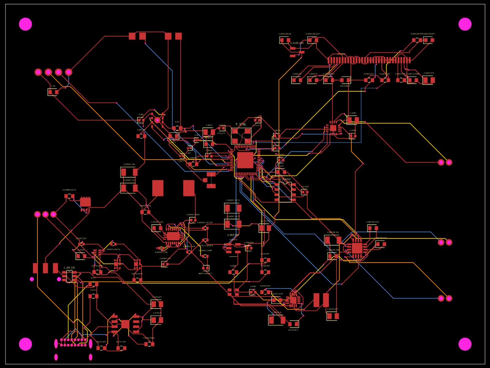

# PAO 实验性一体化 PCB

本目录使用 tscircuit 描述 120 × 90 mm、四层的 PAO 主板。电池充电与保护、5 V 升压、3.3 V 降压、ESP32-S3、SPI Flash、双路电机驱动、I²S 麦克风与功放、OLED 驱动及 USB-C 都在主板上。测距保留 **HC-SR04-33 超声波模组**，通过四针插座连接。四角预留 3.2 mm 安装孔，内层 1 为地平面。



预览图隐藏了内层地铜，以便查看各层走线；[KiCad PCB](pcb/hardware-pcb.kicad_pcb) 保留完整铜层。

设计基于 `hardware/` 中的功能和 `firmware/boards/pao/config.h` 的 GPIO 分配。`hardware/` 里的电磁发射器和继电器未纳入本板；GPIO18 留空，没有发射器接口或驱动电路。

## 接口

| 接口                  | 用途                                                   | 限制                                                     |
| --------------------- | ------------------------------------------------------ | -------------------------------------------------------- |
| J_BAT                 | 1S 锂电池：1 = 正极、2 = 负极、3 = 10 kΩ NTC           | 须核对电池线序；没有 NTC 时充电温度检测不能正常工作      |
| J_MOTOR_R / J_MOTOR_L | 两路 5 V 直流电机                                      | 上电前核对堵转电流与 DRV8833、升压器、电池及连接器额定值 |
| J_SPEAKER             | 差分扬声器输出                                         | 两端均不能接地                                           |
| J_US                  | 3.3 V HC-SR04-33：1 = VCC、2 = TRIG、3 = ECHO、4 = GND | 只可直接接支持 3.3 V 供电及 Echo 电平的版本              |
| J_USB                 | USB-C 5 V 充电及 ESP32-S3 原生 USB                     | 充电时关闭电池负载开关；本板没有充电电源路径管理         |
| J_RF                  | U.FL 外接 2.4 GHz 天线                                 | 射频匹配元件需依据实板和天线调试                         |

J_US 使用 Samtec `SSW-104-01-G-S` 2.54 mm 四针母座，Trig 接 GPIO8、Echo 接 GPIO9，保留现有固件时序。普通 5 V HC-SR04 的 Echo 可能高于 ESP32-S3 允许电压，不能按本接口直接插接。[HC-SR04-33 数据手册](https://cdn.sparkfun.com/assets/a/8/9/c/a/HC-SR04-33_Datasheet.pdf)、[Samtec 插座 PCB 孔位](https://mm.digikey.com/Volume0/opasdata/d220001/medias/docus/6129/ssw-s.pdf)。

## 电路组成

单节电池由 TP4056 充电，BQ29700 和背靠背 MOSFET 提供保护。滑动开关控制高侧 P 沟道 MOSFET，切断升压输入；TPS61088 生成约 5 V，TPS62132 生成 3.3 V。TP4056 的 12 kΩ PROG 电阻对应约 100 mA 充电电流；装配前须按选定电池重新核算。电机使用 DRV8833 替代原 MX1508 模组，但保留 GPIO11–14 的两路控制分配。麦克风使用 INMP441，功放使用 MAX98357A；状态灯由 GPIO48 驱动 WS2812B-2020。OLED 使用 `UG-2864HSWEG01` 的 30 极裸屏并在板上配置 SSD1306 所需外围，0.7 mm FPC 焊接接点需要与屏厂确定热压工艺及机械固定方式。

除超声波传感器及外接电池、电机、扬声器、天线外，电路功能由板上元件实现。若电机、扬声器、电池型号变化，应重新核对电流、热设计和连接器线序。[ESP32-S3 设计指南](https://documentation.espressif.com/esp-hardware-design-guidelines/en/latest/esp32s3/index.html)、[TPS61088 数据手册](https://www.ti.com/lit/ds/symlink/tps61088.pdf)、[CSD25402Q3A 数据手册](https://www.ti.com/lit/ds/symlink/csd25402q3a.pdf)、[OLED 数据手册](https://www.mouser.com/datasheet/2/737/UG_2864HSWEG01-2489760.pdf)。

## 构建与验证

需要 Node.js 24+、pnpm 10.32.1、Bun 和 Go Task。进入 `experimental/hardware-pcb/` 后运行：

```sh
task setup
task check
```

`task check` 检查格式、代码、网络表、摆放、布线、铜层短路和走线风格；`task build` 单独生成工程，`task bom` 更新 `BOM.csv`，`task dev` 启动预览。在仓库根目录调用时加 `hardware-pcb:` 前缀，例如 `task hardware-pcb:check`。

`pcb/` 保存可直接用 KiCad 打开的 PCB 与七页原理图；`task build` 的新产物位于 `dist/hardware-pcb/`，更新已提交的 KiCad 工程时需同步对应文件。原理图、电路源码、KiCad 工程及检查结果用于设计审阅；投入生产前需要完成实物尺寸确认、PCB DRC、USB 差分阻抗与走线长度检查、射频匹配、电源满载与堵转测试，以及 OLED 装配试验。本设计未经过实物验证。USB 静电保护器的 SOT-23-6 三维模型尚未包含在工程中，不影响二维 PCB 和原理图。

原理图自动排版检查仍会提示少量标签碰撞、电容分组及较长的接地标注路径，需要在 KiCad 中人工整理后再用于生产文档。

`BOM.csv` 列出所有板上器件的标称值和已经选定的制造商料号；未标料号的阻容件仍需按电压、容差和温度范围选型。电池与电机型号未确定，电源、电机铜线宽度及过孔载流能力仍需按实际电流和选定板厂层叠复核。
