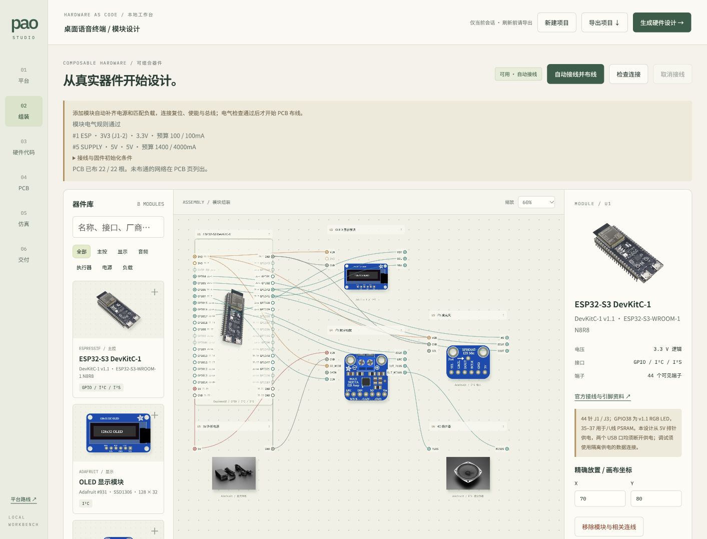
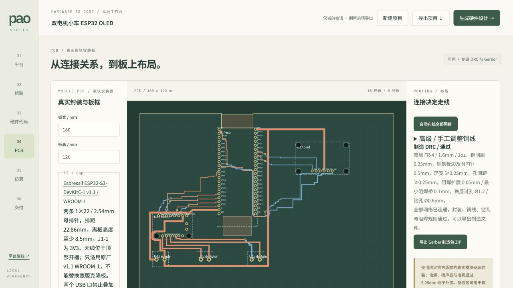
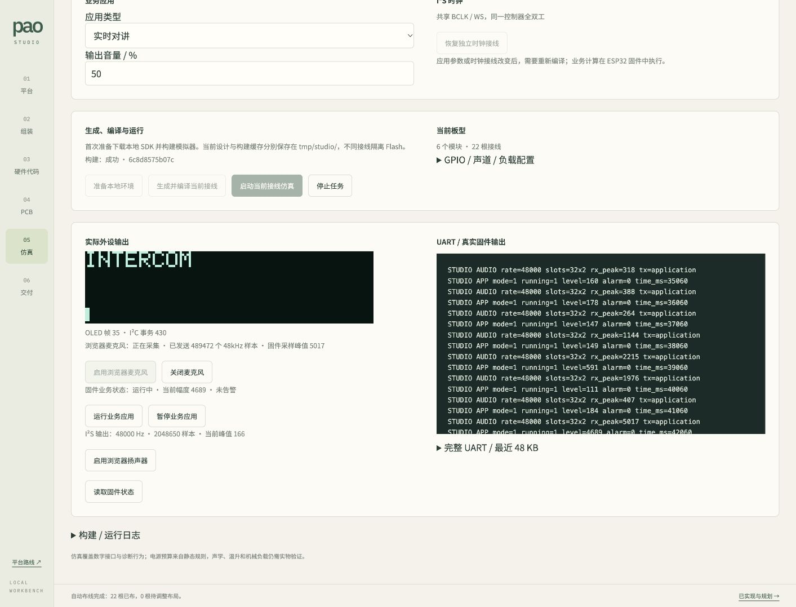
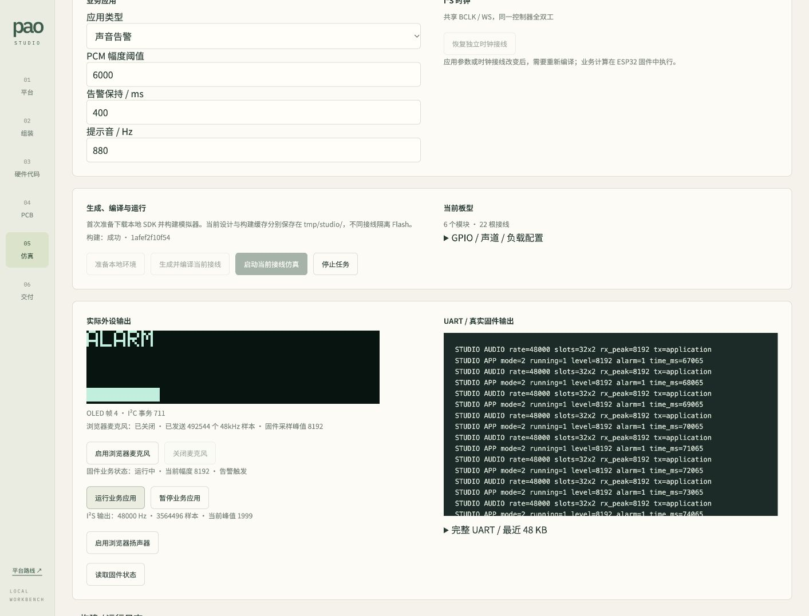
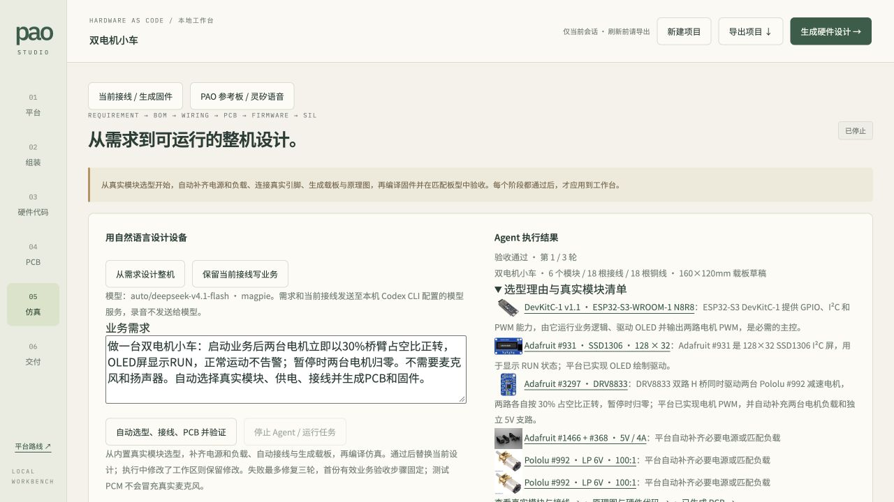
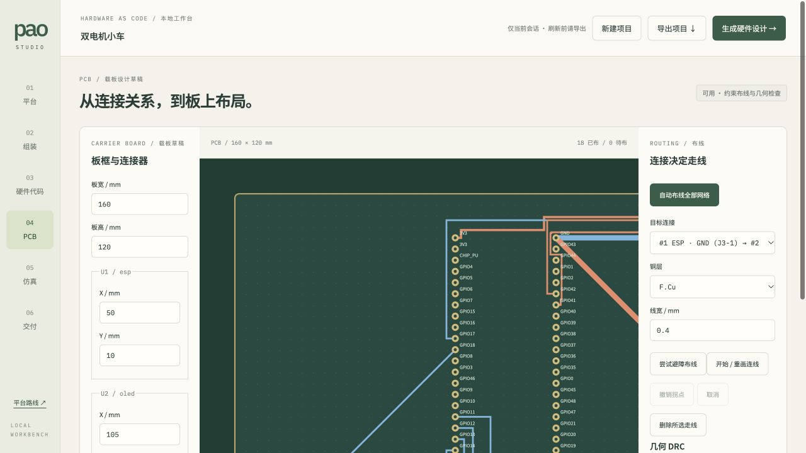

# PAO Studio

把硬件做成模块，把嵌入式开发带入软件工程工作流。

位于仓库 `experimental/platform/` 的实验性 React / TypeScript 本地工作台，面向独立开发者和小型硬件团队。组合真实器件、逐针接线、用 tscircuit 生成模块接口原理图，并在工作台管理 esp32sim PAO 运行时。平台方向见 [Issue #29](https://github.com/pao-1024/pao/issues/29)。



## 启动

需要 Node.js 24+、pnpm 10.32.1 与 Task v3。从仓库根目录执行：

```sh
task platform:dev
```

访问 <http://127.0.0.1:4173/>。项目只保留在当前页面会话，刷新前导出 JSON；当前没有导入或云端保存。端口被占用时启动失败，不自动切换端口。

生产构建与本地预览（含运行时管理 API）：

```sh
task platform:setup
task platform:check
task platform:build
pnpm --dir experimental/platform run preview
```

构建产物在 `tmp/platform-dist/`。检查入口与 Platform CI 一致：`pnpm run check` 执行类型检查、连接与 PCB 几何回归、真实 tscircuit 生成；`pnpm run build` 执行类型检查与 Vite 构建。tscircuit 引擎在用户点击生成时由独立 Worker 加载，不阻塞编辑器主线程；初次生成需要加载较大的引擎资源。

## 器件与组装

内置 ESP32-S3-DevKitC-1 v1.1（N8R8）、Adafruit SSD1306 六针 128×32 OLED、SPH0645、MAX98357A、DRV8833，以及 5V/4A 电源与 DC 转接端子、4Ω/3W 扬声器和 Pololu #992 电机。官方图片、资料与许可见[来源说明](public/modules/SOURCES.md)。

另支持 Adafruit MCP9808 #1782 原版八针温度模块、BH1750 #4681 光照模块、SHT31-D #2857 原版七针温湿度模块。传感器可重复添加，自动连接 VIN/GND/SDA/SCL、地址脚和必要复位：MCP9808 分配 0x18–0x1F，BH1750 为 0x23/0x5C，SHT31 为 0x44/0x45。共享总线与地址均从实际接线推导，修改引脚后固件与模拟器同步使用新配置；最多两个硬件 I²C 控制器。地址冲突、不完整共享时钟/数据、5V 上拉直连、供电预算超限及过强并联上拉会阻止编译和导出。

新增传感器时画布将载板扩展至至少 180×160mm；模块使用官方原版机械封装、全部通孔和安装孔。实际采购版本须匹配型号说明，不能替换成不同针序的 STEMMA QT 版本。

- 按厂商、型号、接口搜索，按类别筛选；点击器件或拖入画布添加，最多 20 个模块。
- 拖动器件标题移动，或在属性面板用 X/Y 坐标精确放置；缩放后移动坐标仍对应画布空间。
- 添加器件即补齐电源和匹配负载，按模块电气规则接线；“自动接线并布线”可重新执行。已有人工连接保留并重新校验；合规人工铜线固定，自动铜线重新规划。支持单 ESP32、每类一个有源外设和两台电机；接口分配不明确时提示错误。
- 手动接线作为调整入口：点击起点端子，再点击终点。Esc 或“取消接线”取消。点击线路查看两端；接线表逐根移除或导出 CSV。
- ESP32 保留 44 个 J1/J3 具名引脚；端子面板是逻辑引出，不表示图像的实物针序、比例或封装。
- 重复连接、自连接、保留脚、电源短接或并联、过压、过电流预算、时钟/数据/复位角色混接、桥臂输出短接、差分负载接地均被拒绝。校验已有接线时同样执行这些规则。
- 删除模块或连线时，相关 PCB 走线同时删除。

默认语音终端为 6 个模块、22 根连接，包含电源、扬声器与 OLED 复位。添加 DRV8833 后自动补齐两台电机，形成 9 个模块、33 根连接；参考布局按 ESP32 引脚侧分配连接器，两套方案均可完整自动布线。缺电源、公共地、负载、复位或使能时，暂停自动 PCB 布线和原理图生成，不能仅凭“端子已连接”通过检查。

## 模块电气规则

- 5V/4A 外部电源经 Adafruit #368 中心正极 DC 转接端子供电，主控、功放和电机驱动分别引出电源与地回线。ESP32 采用 5V 排针供电；两个 USB 口均须断开供电，禁止混用供电方式。
- 主控 5V 输入预留 600mA（含本体 500mA 与对外 3.3V 100mA 的项目额度）。OLED、麦克风分别按 90mA、10mA 预留；这是保守设计额度，并非实测峰值或稳压器额定极限。功放从外部 5V 取电，预留 800mA，不从 ESP32 的 3.3V 输出取电。
- 六针旧版 OLED 的 RST 接 GPIO17；驱动须在供电稳定后拉低 1ms，再拉高并初始化。其板载 I²C 接口上拉至 VIN，因此直连 ESP32 时 VIN 取 3.3V。5V VIN 与 ESP32 GPIO 的组合无论以何种顺序连接都会报错。GPIO38 为 v1.1 板载 RGB LED，35–37 用于该型号 PSRAM，启动与 USB/UART 保留脚均禁止分配。
- SPH0645 SEL 可接地或 3.3V，分别选择左/右声道；默认接地。MAX98357A SD_MODE 接 3.3V 选择左声道，GAIN 接地为 12dB；两端只接同一台 4Ω/3W 扬声器，检查阻抗和额定功率，禁止任一输出接地。
- DRV8833 VMOTOR 接外部 5V，SLP 接 GPIO18。固件必须保持 SLP 低，先将四路控制脚置低，再使能。两台 Pololu #992 分别接 A/B 输出；每台按 6V 下 360mA 理论堵转电流预留，在本方案 5V 下使用，低于驱动板默认每通道 1A 限流。堵转值用于启动电流预算，不表示允许持续堵转。FLT 未使用；需要使用时须先建模外部上拉。

页面展示逐路电流预算：语音方案 5V 为 1400/4000mA，增加电机后为 2120/4000mA；对外 3.3V 为 100/100mA。GPIO 角色、复位/使能初始电平及 I²S 48kHz / 32位双槽（BCLK 3.072MHz）参数随项目 JSON 导出，也可在固件页单独导出 `electrical-contract.json`。实际驱动必须按导出配置实现初始化；这些静态规则不等于已运行该组合的固件。

厂商具体型号不等于 PAO 原板型：SPH0645 不是 INMP441，DRV8833 不是 MX1508，六针 128×32 OLED 不是 PAO 四针 128×64 OLED。不得将官方外观替换误认为驱动与仿真模型兼容。

## tscircuit 硬件生成

硬件代码页从当前模块和连接生成可下载的 TSX。点击“生成原理图”实际调用 `@tscircuit/core`，输出 Circuit JSON 和原理图 SVG；连接或模块变化后旧生成结果失效。错误直接展示，超过 60 秒终止本次生成。

器件用具名端子的 `chip` 表达外部接口，不展开内部电路，PCB 生成关闭。固件页只编辑草稿，不编译、不自动修改 GPIO，也不会下发给模拟器。不会执行用户输入的任意 TSX。

## 模块 PCB 与打板文件



PCB 与接线共享端点数据，电气规则通过后在 Worker 中自动布线，编辑器保持可操作。修改接线或 PCB 布局会终止旧任务并重新规划；拖动组装外观位置不会重算 PCB。最多 45 秒停止本次布线，保留具体失败信息。合规人工铜线固定，自动铜线最多进行三轮失败网络优先重排。多分支网络从已连通的同网焊盘引出；短路径失败后用双层 A* 搜索和换层过孔，采用 0.5mm 网格并保留精确的端点坐标轴，最多每层 180,000 个网格点、合计 120,000 次展开。不保证任意布局布通，未布通时列出具体网络并禁止制造导出。

封装数据见 `src/footprints.ts`，采用固定版本的官方机械尺寸和针序，界面可打开对应来源：

- [Espressif DevKitC-1 v1.1 尺寸图](https://dl.espressif.com/dl/schematics/esp_idf/DXF_ESP32-S3-DevKitC-1_V1.1_20220429.pdf)：两条 22 针排针，间距 2.54mm、排距 22.86mm；为 WROOM-1 天线预留板边开槽与无铜区域，另保留 USB 操作空间。
- Adafruit 原版六针 [#931 OLED](https://github.com/adafruit/Adafruit-128x32-I2C-OLED-Breakout-PCB)、[#3421 SPH0645](https://github.com/adafruit/Adafruit-I2S-Microphone-Breakout-PCB)、单声道 [#3006 MAX98357A](https://github.com/adafruit/Adafruit-MAX98357-I2S-Amp-Breakout)、[#3297 DRV8833](https://github.com/adafruit/Adafruit-DRV8833-Motor-Driver-Breakout-PCB)：真实板外形、全部物理焊盘和 M2.5 支柱孔。包含 DRV8833 未使用的 ASEN/BSEN 及输入端子孔，不允许铜线穿过这些孔。
- 外部电源、扬声器及电机使用 [Phoenix MKDS 1,5/2-5,08 / 1715721](https://github.com/KiCad/kicad-footprints/blob/7ebfa6b23cc292a56f751b7b5f4a0e12eeef69dd/TerminalBlock_Phoenix.pretty/TerminalBlock_Phoenix_MKDS-1%2C5-2-5.08_1x02_P5.08mm_Horizontal.kicad_mod) 端子连接；外部设备本体不安装在 PCB 上。

模块通过母排针及至少 8.5mm 高的绝缘支柱安装，按装配图方向插入。MAX98357A 的输出采用真实 3.5mm 间距通孔：不要焊装模块原配输出端子，改用两根绝缘直通引线焊接至载板对应孔。DRV8833 的 5V 由 VMOTOR 排针输入，会绕过模块反接保护，必须按极性接线。更换硬件版本或使用尺寸不同的克隆板时不能沿用现有封装。

制造规则针对两层、1.6mm FR-4、1oz 外层铜和通孔手工装配。信号/配置支线至少 0.4mm、3.3V 电源 0.5mm、负载 0.8mm、5V/地母线 1.2mm；铜间距 0.25mm、铜到板边及 NPTH 0.5mm、钻孔间距 0.25mm、环宽至少 0.25mm、阻焊扩展 0.05mm、阻焊桥至少 0.1mm。过孔焊盘 1.2mm、钻孔 0.6mm，模块排针成品孔 1mm、外接端子孔 1.3mm、NPTH 支柱孔 2.7mm。

点击“导出 Gerber 制造包 ZIP”前必须通过电气、模块占位、全网络铜连接、禁布区及上述制造规则；缺线、重复铜线、改动过孔或间距不合规都会阻止导出。ZIP 包含双面铜层 `.gtl/.gbl`、双面阻焊 `.gts/.gbs`、顶丝印 `.gto`、带天线开槽的闭合板框 `.gm1`、PTH/NPTH Excellon、装配 SVG、BOM、封装来源、PCB JSON、DRC 报告和工艺说明。通孔手工焊接不需要锡膏层。Gerber 与钻孔均使用毫米、左下角原点；底层不镜像，孔径是成品孔尺寸。支持这些标准文件的工厂可用于裸板打样，下单前核对工厂 CAM 预览和实际采购的模块版本。

独立 CAM 校验入口使用 Gerbonara 1.6.3 解析实际导出文件、Shapely 2.1.2 检查铜间距、板边、NPTH 及跨层连接，并生成实际 CAM 预览。`uv` 按脚本声明安装隔离依赖：

```sh
uv run experimental/platform/check-manufacturing.py tmp/pao-pcb-fabrication.zip
```

Adafruit 机械数据由 Limor Fried/Ladyada 为 Adafruit Industries 设计，采用 [CC BY-SA 3.0](https://creativecommons.org/licenses/by-sa/3.0/)；固定源文件链接随 `footprints.json` 导出。KiCad 端子几何来自 KiCad 封装库，采用 CC-BY-SA-4.0 与 library exception。打板文件不包含采购模块的内部 PCB。静态 DRC 不代替样板装配、回流路径、载流温升、射频、声学及实际波形验证；平台不会自动下单。

## esp32sim 真实运行时

本地运行时使用 POSIX 进程组与文件锁，支持 macOS / Linux。



仿真页根据当前接线与业务参数生成 ESP-IDF 应用固件，可选择实时对讲、声音告警或模块诊断。接线图经过电气与资源校验后，生成 `wiring.h`、驱动程序、CMake 工程与 `board.json`。编译产生的 ESP32-S3 ELF 和 Flash 镜像在 esp32sim 中从 ROM 启动，虚拟外设使用同一份板型配置；页面从 WebSocket 接收实际显存、音频、GPIO/MCPWM 和 UART。只有收到当前板型及固件 READY 才显示就绪。

在页面点击“准备本地环境”，SDK、工具链、参考固件、Rust 模拟器和参考网页会安装或构建到本 worktree 的 `tmp/`。随后点击“生成并编译当前接线”和“启动当前接线仿真”。环境与原 PAO 参考板的命令行入口仍为：

```sh
task simulator:prepare
task simulator:run
```

首次准备需要联网下载 ESP-IDF 6.0.1 和工具链，也需要本机有 Git、Python 3.10+、Task、pnpm、Rust 和 C/C++ 构建工具。生成工程、编译输出和 Flash 保存在 `tmp/studio/<内容标识>/`；内容标识覆盖接线与源码，接线改变后必须重新成功编译。停止会发送中断让模拟器保存状态；8080/8081 被其他服务占用时不会接管或终止它。固件页显示生成配置与程序，并可导出完整源文件 JSON（路径到文件正文的映射）；构建目录本身可直接作为 ESP-IDF 工程使用。

实时对讲需要麦克风、功放和匹配负载，可设置 0–100% 输出音量。点击“运行业务应用”，固件将实际 I²S 接收的选定声道复制到发送双槽，应用音量；暂停后保持采集但输出静音。OLED 显示 `INTERCOM` / `PAUSED` 与实时幅度条。

声音告警同样需要麦克风和功放：幅度达到原始 PCM 阈值时，固件输出指定频率的提示音；输入回落后保持指定时长，再自动恢复监听。阈值范围 100–30000，保持时间 100–10000ms，提示音 100–2000Hz。OLED 显示 `LISTENING` / `ALARM`，页面状态来自固件遥测，不在浏览器模拟判断。阈值是 PCM 幅度，不是经过校准的声压级。



先点击“启用浏览器麦克风”并允许采集，音频经 AudioWorklet 重采样为 48kHz、打包为有界 PCM16 帧，按实际 BCLK / WS / DOUT 和 SEL 声道进入模拟器。不会自动注入测试音。需要听取输出时另行启用浏览器扬声器，建议使用耳机避免对讲回授。关闭麦克风、停止、离开仿真页、设计变化或连接断开都会释放采集设备；权限拒绝与发送积压在页面提示。

点击“自动改为共享时钟接线”可将麦克风 BCLK / WS 自动接至功放时钟 GPIO。共享时钟使用同一 I²S 控制器全双工，接收时钟跟随 TX；独立接线使用两个主控通道。部分共用时钟或 RX/TX 争用数据 GPIO 会被拒绝。应用参数和接线共同参与构建标识，修改后需要重新编译。

内置模块还提供以下驱动与诊断行为：

- 六针 SSD1306：按实际 GPIO 拉低复位后初始化 128×32、通过 I²C 写四页显存，页面按钮切换图案。虚拟 OLED 在复位低电平时不应答，I²C 设备按实际 SDA/SCL 匹配。
- SPH0645：48kHz、32位双槽，按 SEL 读取左/右声道，UART 报告实际采样峰值。
- MAX98357A 与匹配扬声器：业务应用音频输出，诊断模式下也支持静音或 440Hz 测试音；页面显示实际 PCM 采样率、样本数与峰值。
- DRV8833 与两台电机：复用仓库 Motor 驱动，控制脚初始化为低后再使能 SLP。UART 接受 `motor A B`（百分比范围 -50..50）、`stop`；命令一秒后自动归零。页面按实际 GPIO/MCPWM 与负载极性显示桥臂占空比，不把它当作实测转速。
- 不存在的模块不初始化；仅 ESP32 与电源的精简组合也可以编译启动。诊断命令还包括 `status`、`display`、`tone`、`mute`，未安装外设对应的命令会被拒绝。

“PAO 参考板 / 灵矽语音”保留原正式固件及固定 PAO 外设。新虚拟设备的云端语音交互需要按提示绑定灵矽；参考板的浏览器麦克风需用户主动授权。两种板型共用一个本地运行时，不能同时运行。本地 API 拒绝外站发起的控制请求，只允许 `127.0.0.1` 工作台同源调用，不应暴露到公网；单独托管 `platform-dist` 静态文件不提供运行时管理服务。

电源、去耦和载流来自静态规则；模拟器不模拟温升、声学环境、机械负载或电机堵转电流。装配前核对实物版本与导出的封装、针序及安装说明。

## 自然语言整机与业务开发





仿真页默认选择“从需求设计整机”。输入需求并点击“自动选型、接线、PCB 并验证”，Agent 从真实器件目录选择功能模块并解释理由；平台补齐必需电源和匹配负载，按电气规则分配引脚、接线和布局。独立 Node Worker 完成约束布线、几何检查及真实 tscircuit 原理图生成，最多执行 60 秒，可随时取消。未布通网络或几何问题不能继续进入固件编译。

硬件生成通过后，平台把同一份接线和业务接口交给 Codex CLI，生成 C++ 业务函数和有序验收步骤，自动完成 ESP-IDF 编译、ROM 启动、测试 PCM 注入与结果检查。选型、布线、编译、启动或验收错误会反馈给模型，最多运行三轮；第一份有效业务验收步骤在修复中保持不变。目录外的器件明确拒绝，不虚构模型或替换需求。也可以选择“保留当前接线写业务”，只生成当前硬件上的业务程序。

成功后，模块、连接、板框、已校验铜线、原理图和业务程序会一起应用到工作台，不重新覆盖已生成结果。执行期间改过工作区时不会自动覆盖，页面提供“应用已生成的完整设计”供检查后手动应用。可以在组装、硬件代码、PCB 和仿真页查看同一份结果；项目 JSON 包含原理图和硬件源码。首次生成使用内置真实模块安装布局，板宽范围 140–200mm、高度范围 100–160mm，尚未提供任意机械约束求解。

整机工程保存在 `tmp/studio/<内容标识>/`，除 ESP-IDF 文件外还包含 `hardware-project.json`、`hardware.tsx`、`schematic.svg`、`circuit.json`、`pcb.json` 及同一设计的全部制造文件。制造 DRC 通过后才进入固件编译和 SIL。可以导出完整工程，再次启动匹配固件并接入浏览器麦克风。停止同时取消模型生成、硬件 Worker、编译或仿真，不继续下一轮。

需要 Python 3.11+（读取 TOML 配置）以及已安装的 Codex CLI，当前集成验证版本为 0.163.0。默认模型 `auto/deepseek-v4.1-flash` 对应 `DeepSeek V4.1 Flash · routing group`，使用本机 Codex 的 `magpie` 供应商；供应商地址、认证与请求头仅从本机配置读取，不写入项目或发送到浏览器。可在启动工作台前使用 `PAO_AGENT_PROVIDER` / `PAO_AGENT_MODEL` 指定已有供应商和模型。缺少配置、登录或模型服务时，界面显示实际错误，不回退为预设应用。

CLI 运行在只读模式，关闭 Shell、MCP、插件与网页搜索，只加载所选供应商配置。需求、接线和错误日志会发送到该模型服务，麦克风录音不发送给模型；模型调用会使用相应账号额度。

业务函数通过 `StudioOutput studio_step(bool running, int level, int64_t now_ms)` 控制当前模块：PCM 峰值与时间作为输入，输出对讲音量、提示音频率、OLED 英文标签、告警状态和两路电机速度。平台保留驱动、初始化、引脚、声道与负载极性，并校验输出范围；业务源码参与工程内容标识。它支持在已建模模块和接口内编写新逻辑，不支持凭空增加传感器、云端语音服务或任意驱动。

验收步骤检查固件遥测、实际 I²S PCM 幅度与提示音频率、电机桥臂占空比，要求 OLED 显存到达，并验证暂停后的输出归零。步骤由模型提出，界面显示源码、预期值与逐轮证据；通过这些步骤不代表需求已被完整形式化证明。当前本地编译入口不构成面向恶意 C++ 的多租户隔离服务，不能直接开放到公网；不会自动刷写实物。

传感器业务通过 `StudioSensor studio_sensor(int moduleId)` 读取 `valid`、`temperatureC`、`humidityPercent`、`lux`，不存在的物理量为 NAN；业务必须先检查有效状态。驱动约每 200ms 执行真实 I²C 事务，SHT31 校验 CRC。浏览器“模拟环境输入”和 Agent 场景的 `inputs` 使用 °C、%RH、lx，刺激进入器件寄存器，再由编译固件采样；不是把结果直接写进业务函数或 UART。传感器验收步骤至少 750ms，会检查寄存器读数与最终业务输出。可输入“两路温度、湿度或暗光越界时显示 ALERT，恢复显示 NORMAL”自动选择多个模块并生成整机。

模块目录与约束分别见 `src/sensors.ts`、`src/electrical.ts`；真实固件驱动在 `firmware/main/sensor-driver.h`，对应数字器件模型在 `simulator/pao-sim/src/sensors.rs`。新增型号须同时补齐引脚/地址/供电、原厂机械封装、驱动、寄存器仿真及行为验收，才可加入 Agent 选型；未登记型号不会被自动替换或假装支持。模拟器覆盖当前驱动使用的测量模式，不模拟传感器的模拟噪声、精度漂移、热传导、光路或全部芯片工作模式。

CLI 的非交互结构化输出参见 [Codex 官方文档](https://learn.chatgpt.com/docs/non-interactive-mode)。

## 能力状态

- 已实现：官方器件资料、可组合接线、真实 tscircuit 原理图生成、约束布线与几何检查、源码导出、实时对讲/声音告警应用固件生成与编译、真实浏览器麦克风、独立/共享 I²S 时钟及动态板型软件在环运行，以及独立的 PAO 参考板语音仿真。
- 已实现：Agent 按自然语言选择内置真实模块，自动组装、接线、生成载板与原理图，再生成 C++、编译和 SIL 场景验收，反馈错误进行有上限的修复。
- 已实现：内置模块安装封装、安装孔、天线开槽、双层布线与过孔、制造 DRC、Gerber/钻孔制造包及独立 CAM 校验入口。
- 规划中：更多外设与驱动、批量 SIL 回归、硬件在环（HIL）、实物样板装配与功能验收。

平台价值是减少实物等待、配置不一致与可提前发现的打板返工。仿真不替代电气、射频、声学、功耗与实物验证，不承诺百分百还原所有硬件。

交互布局参考 <https://learn-arduino-red.vercel.app/zh/>；采用器件居中、具名端子、官方资料旁置的工作台结构，不复制参考站素材或源码。
