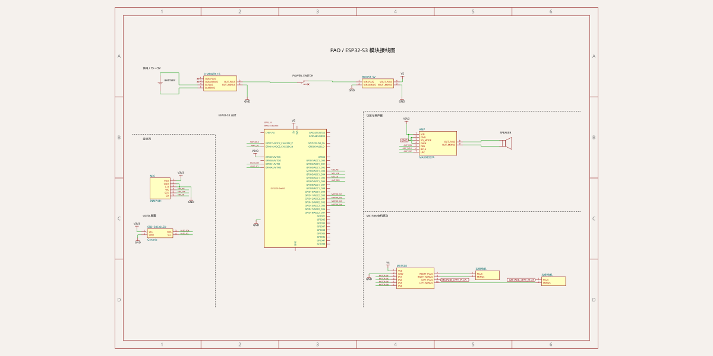

# PAO 模块接线图

使用 [tscircuit](https://tscircuit.com/) 的 TSX 描述用户提供的[小智机器人接线方案](reference-wiring.jpg)。本版按图连接供电、ESP32-S3、MX1508 电机驱动小红板、INMP441、MAX98357、扬声器和 SSD1306 OLED，省略图中标注可选的三个外接按钮。

这是**模块之间的接线参考**，尚未实物验证。ESP32-S3 保留官方 44 个物理引脚；其他本地接口中的 `pin1` 等是符号索引。接线按 GPIO 名称和模块丝印确认。本目录仅用于模块接线，未验证 PCB 封装、机械尺寸或模块内部电路，不生成可生产的 PCB。



## 模块与供电

| 图中模块 | 本版描述 |
| --- | --- |
| 1S 锂电池 | 电池正负极接充电保护板 B+/B− |
| 1S 充电保护板 | 采用已有 TP4056 保护板接口参考；自带 USB 充电口，负载使用 OUT+/OUT− |
| 三脚开关 | COM 与 ON 串联在保护板 OUT+ 和升压输入之间，另一脚不接 |
| 5V 升压板 | 采用已有 MT3608 四端子接口参考；输出设为 5V，给主控与电机驱动供电 |
| ESP32-S3 开发板 | 按原图的 44 针 DevKitC 排针名称描述，板载稳压输出 3V3 |
| MX1508 电机驱动小红板 | 型号已确认；描述电源、IN1–IN4、左右两路电机输出 |
| INMP441 麦克风 | 3V3，I2S 输入 |
| MAX98357 功放及扬声器 | 按原图 VIN 接 3V3，I2S 输出至差分扬声器端子 |
| SSD1306 I2C OLED | VCC 接 3V3；目标为图中标注的 128×64，尺寸与分辨率以实物为准 |

原图将小红板标作 L298N，实际型号已确认是 **MX1508**。IN1/IN2 控制右电机，IN3/IN4 控制左电机，电源接升压板的 5V 输出。充电板与升压板的实际芯片型号尚未确认，上述选型仅复用同类模块的接口定义。

## 现成组件与来源

| 元件 | 实际复用方式 |
| --- | --- |
| 电池、SPDT 开关、扬声器 | tscircuit 内置 `battery`、`switch`、`schematicsymbol` |
| ESP32-S3 开发板 | 原生导入乐鑫官方 KiCad 符号，保留完整 44 针、图形及板上内部电源连接；短 GPIO 别名自动生成 |
| SSD1306 OLED | 复用官方 `@tscircuit/header-modules` 成品组件，只调整固定符号的绘图留白 |
| 左右电机 | 使用内置两针端子，清楚表示外部电机的两线连接 |
| 充电保护、升压模块 | 从已有 MIT 许可的 Fritzing/KiCad 板级定义适配，保留源文件及引脚顺序 |
| INMP441、MAX98357A、MX1508 模块 | 保留小型的本地外部接口定义；目前未找到针脚与本方案一致、可直接导入的整板 TSX 组件，不将裸 IC 或其他开发板当作同款模块 |

所有外部来源、固定提交、许可及必要的格式适配见 [vendor/README.md](vendor/README.md)。官方 header-modules 的同名 ESP32-S3 组件目前仍为 30 针映射，与本图 44 针开发板不符；MAX98357A 候选缺少扬声器端子，TP4056/MT3608 候选也缺少本方案所需的电源端子，因此未直接套用。

## 源码组织

按项目锁定的 [tscircuit skill](https://github.com/tscircuit/skill/blob/ccfd1afbefa0d1fb0f995795e805030ee5e96de1/SKILL.md) 组织为一张图纸，使用 `schematicsection` 划分供电、主控、麦克风、扬声器输出、屏幕和电机六个功能区。各模块通过 `schSectionName` 归属分区，坐标显式设置；分区不会自动排版。

`index.tsx` 负责组合组件、命名网络和布局。`components/` 只保留必要的模块接口与适配；`vendor/` 保存复用的原始定义和许可。KiCad 符号通过 tscircuit 原生导入，测试复用上游连通性工具。`tscircuit.config.ts` 统一关闭 PCB 与元件选型引擎，供构建、导出和开发预览使用。

## 信号连接

下表与原图一致，可直接作为固件的 GPIO 配置依据。

| 模块 | 信号 | ESP32-S3 GPIO | DevKitC-1 排针位置 |
| --- | --- | --- | --- |
| INMP441 | WS | 4 | J1-4 |
| INMP441 | SCK / BCLK | 5 | J1-5 |
| INMP441 | SD，麦克风输出 | 6 | J1-6 |
| MAX98357 | DIN，功放输入 | 7 | J1-7 |
| MAX98357 | BCLK | 15 | J1-8 |
| MAX98357 | LRC / LRCLK | 16 | J1-9 |
| MX1508 | IN1，右轮 | 11 | J1-17 |
| MX1508 | IN2，右轮 | 12 | J1-18 |
| MX1508 | IN3，左轮 | 13 | J1-19 |
| MX1508 | IN4，左轮 | 14 | J1-20 |
| OLED | SDA | 41 | J3-7 |
| OLED | SCL | 42 | J3-6 |

电源排针：5V 为 J1-21，3V3 为 J1-1/J1-2，GND 可用 J1-22 或 J3-1/J3-21/J3-22。位置依据[乐鑫 DevKitC-1 引脚表](https://docs.espressif.com/projects/esp-dev-kits/en/latest/esp32s3/esp32-s3-devkitc-1/user_guide_v1.1.html#header-block)；手中开发板的型号、方向和丝印仍需一致。

GPIO39、40、0 的三个外接按钮未接入，板载 BOOT/RESET 不受影响。GPIO41/42 用于 OLED 后会占用对应的外部 JTAG 引脚；USB GPIO19/20 保留。

## 电源与固定连接

```text
1S 电池 B+/B− → 充电保护板
保护板 OUT+ → 开关 COM/ON → 升压板 VIN+
保护板 OUT− → 升压板 VIN−/VOUT− → 系统 GND
升压板 VOUT+（5V）→ ESP32-S3 5V、电机驱动 VCC
ESP32-S3 3V3 → 麦克风 VDD、功放 VIN/SD、OLED VCC
```

- 电池负极 B− 与系统 GND 分开，负载通过保护板 OUT− 回流，避免绕过保护。开关的实际公共脚须按丝印或通断测量确认；图中的开关符号只表示外部接线，不模拟开关状态。充电口内置于充电板，未另画连接器；未知模块是否有电源路径管理，充电时关闭系统开关。
- 电机供电从升压输出直接分支，电机电流不经过开发板排针或 3V3 稳压器。核对电池、保护板、升压板和驱动板能否承受电机堵转与整机峰值电流。
- 功放保持原图的 **3V3 供电**。实际音量和扬声器负载必须在开发板 3V3 稳压器的电流余量内；模块应有厂家要求的去耦。切换供电方案时同步修改 TSX、测试和接线表。
- 麦克风 L/R 接 GND，选择左声道。原图未画出 SD 的 100kΩ 下拉和去耦，应确认模块已包含厂家要求的外围电路；若引出 CHIPEN 则确认已使能。[INMP441 数据手册](https://invensense.tdk.com/wp-content/uploads/2015/02/INMP441.pdf)
- 功放 SD_MODE 接 3V3，GAIN 接 GND，按 MAX98357A 对应左声道及 12dB 增益。扬声器只接 OUT+ 与 OUT−，两端均不接系统 GND。[MAX98357A/B 数据手册](https://www.analog.com/media/en/technical-documentation/data-sheets/MAX98357A-MAX98357B.pdf)
- OLED 按 **SDA/SCL/VCC/GND 丝印**接线。不同模块的四针排列、尺寸和分辨率可能不同，不能按照片的排针次序替代丝印；本版假定模块已包含 I2C 上拉。
- 按[乐鑫供电说明](https://docs.espressif.com/projects/esp-dev-kits/en/latest/esp32s3/esp32-s3-devkitc-1/user_guide_v1.1.html#power-supply-options)，USB、5V 排针、3V3 排针供电方式互斥。下载固件时切换供电，避免同时从外部升压板和 USB 向开发板供电。

## 本地预览与验证

需要 **Node.js 24+、npm 和 Bun 1.3.10+**。当前锁定版本的 `tsci` 命令使用 Bun 运行；[Bun 安装说明](https://bun.sh/docs/installation)。从仓库根目录执行：

```sh
cd hardware
npm ci
npm run dev
```

浏览器访问命令输出的本地地址（默认 `http://localhost:3020`），查看 Schematic。PCB 已关闭，预览中的 PCB/3D 不代表实际布局。

| 命令 | 用途 |
| --- | --- |
| `npm run typecheck` | 严格检查 TSX 模块属性 |
| `npm run check` | 构建后检查源码、引脚、网络、原理图布局及放置 |
| `npm run build` | 输出 `dist/index/circuit.json` 和 `dist/index/schematic.svg` |
| `npm run export` | 更新已提交的 `schematic.svg` |
| `npm test` | 类型检查、上述检查、构建，并验证编译产物的 GPIO、电源、保护地及输出连接 |

修改接线后执行 `npm test` 和 `npm run export`，把源码与 SVG 一起提交。各项检查复用同一次构建产物，CI 直接比较构建 SVG 与已提交图纸。测试覆盖开发板内部相连的重复电源引脚，并核对 12 路 GPIO、保护前负极隔离及差分输出。模块接口未模拟内部芯片电气特性，引脚检查仍会提示缺少完整电气属性；自动检查不替代实物验证。

`tscircuit-jsx.d.ts` 直接复用上游 `@tscircuit/props` 的属性类型，避免聚合类型入口连带检查路由器包的第三方 TypeScript 源码。
