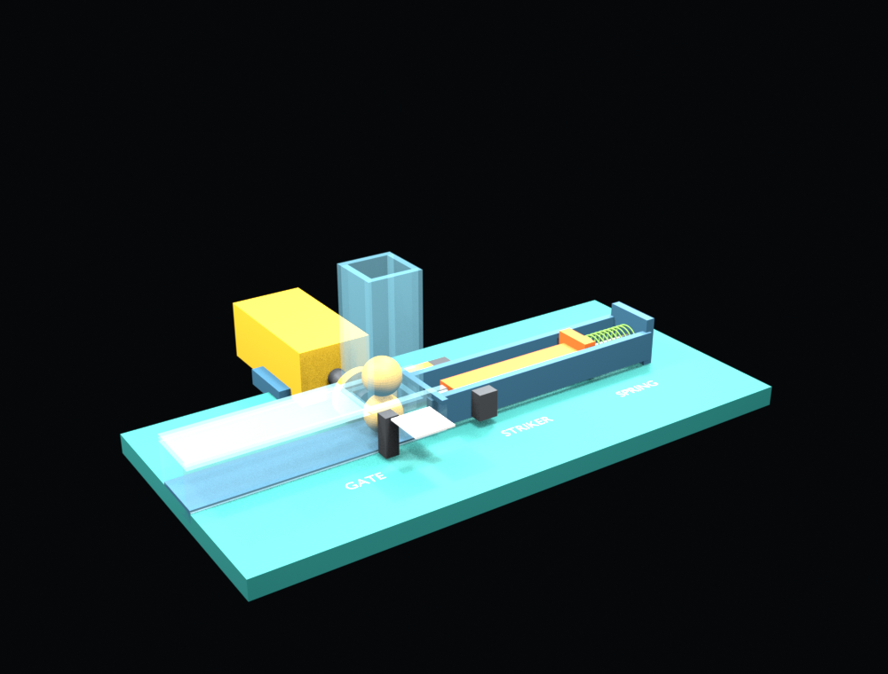

# Blender 三球弹簧发射器

这套场景完全由 Blender Python (`bpy`) 生成，沿用 PR #76 的三球、滑门、弹簧和击针逻辑，不导入 OpenSCAD 或 STL。



## 机构

- 白色横板是计量滑门，夹在第一颗与第二颗球之间。每个周期横移 `20 mm`，只让下一颗球落入发射位，随后关闭并托住上面的球。
- 橙色杆是击针，侧面有两个耳片。一个耳片由金色凸轮滑块后压，另一个耳片在前方止挡处停止。
- 绿色螺旋弹簧在底座后部，套在导向杆外。击针后压时弹簧压缩储能，释放后由 Blender `GENERIC_SPRING` 实际推动击针击球。
- 黄色 TT 减速电机和轴只表示驱动布置；当前仿真中的凸轮滑块与滑门仍按时间轴分别驱动，没有用齿轮或连杆证明同一台电机能同时完成两套动作。这个限制与 PR #76 相同。

一个 `0.5 s` 周期内的关键动作：

| 时间 | 动作 |
|---|---|
| `0.025 s` | 凸轮滑块释放击针 |
| `0.05 s` 前 | 弹簧推动击针并击出已就位的一颗球 |
| `0.20–0.325 s` | 凸轮滑块把击针压回待发位，弹簧重新储能 |
| `0.35–0.40 s` | 滑门横移 `20 mm`，且只放下一颗球 |
| `0.45–0.492 s` | 滑门关闭，等待下一次击发 |

## 仿真

场景使用 Blender 5.2.2，刚体步进 `960 Hz`，记录 `120 fps`、`1.7 s`。球质量约 `0.9 g`，弹簧刚度 `130 N/m`、阻尼 `0.55 N·s/m`。

运行主仿真并生成场景、轨迹和预览图：

```sh
blender --background --factory-startup --python mechanical/blender-cam-launcher/build_launcher.py -- --render
```

生成无弹簧对照：

```sh
blender --background --factory-startup --python mechanical/blender-cam-launcher/build_launcher.py -- --spring-stiffness 0 --output-stem no_spring --no-save
```

执行验收：

```sh
python3 mechanical/blender-cam-launcher/validate.py
```

当前结果：

- 三颗球分别在 `0.1167`、`0.6167`、`1.1167 s` 越过 `x=170 mm` 炮口。
- 炮口速度分别为 `0.900`、`0.883`、`0.876 m/s`，均从炮管内部通过。
- 第 `1`、`60`、`120` 帧的弹仓下段各只有一颗球；第 `180` 帧三颗球都已击出。
- 无弹簧对照组没有任何球越过炮口，弹簧最大储能约 `0.0441 J`。

`launcher.blend` 是已烘焙场景，打开后从第 `1` 帧播放即可查看供弹和击发。模型、时序和接触参数均为仿真假设，尚未进行实体打印、电机负载或皮筋/弹簧实测，不能据此宣称实物可以直接连发。

## 文件

| 文件 | 内容 |
|---|---|
| `build_launcher.py` | Blender 原生建模、刚体、弹簧约束、时序驱动和轨迹导出 |
| `launcher.blend` | 已烘焙的三球场景 |
| `trace.csv` | 120 fps、204 帧的主仿真轨迹 |
| `preview.png` | 第 52 帧滑门放球时的场景预览 |
| `validate.py` | 三球顺序、周期、炮口位置、单球计量和无弹簧对照验收 |

关联 issue：[#61](https://github.com/pao-1024/pao/issues/61)。
