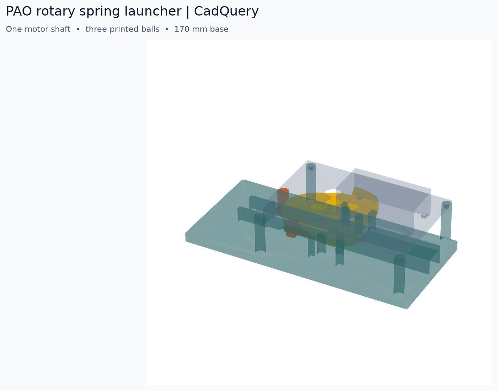
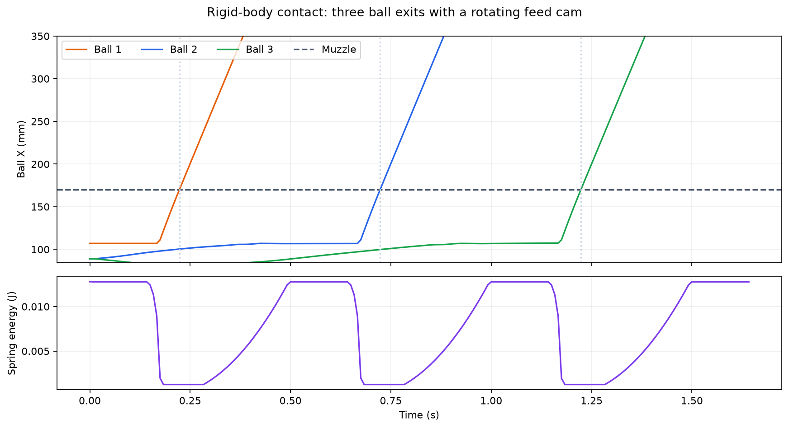

# CadQuery 三球旋转供弹发射器

该机构使用一台黄色 TT 减速电机、一根压缩弹簧**或**两侧皮筋，以及打印件。电机的 D 形输出轴直接带动同一个三孔料盘和三凸轮环；每转 120°，下一颗打印球经固定托盘落入炮膛，凸轮先拉回击针，再由弹簧或皮筋释放击针。没有第二台电机、齿轮传动链、螺钉或扎带。它是独立的机械试装方案，尚未接入 PAO 固件，打印装配与实物连发仍需验收。

## 观察运行

在仓库根目录运行 `task mechanical:animate`，然后打开 `tmp/cadquery-launcher/launcher_motion.mp4`。动画同时显示俯视料盘与侧面剖视击针，按仿真轨迹约 2.5 倍慢放，可以看到三颗球逐个落下和发射。画面隐藏了电机与顶盖，并简化了固定件的轮廓；球、料盘和击针的位置来自 PyBullet 刚体仿真，不是真机录像。生成视频需要系统安装 `ffmpeg`。运行 `task mechanical:preview` 可生成装配图、击针近景 `tmp/cadquery-launcher/striker_preview.png` 和轨迹图；`tmp/cadquery-launcher/launcher.step` 可用支持 STEP 的 CAD 查看器旋转检查。

## 打印文件

在仓库根目录运行 `task mechanical:print`，会在本 worktree 的 `tmp/cadquery-launcher/stl/` 生成下表全部待打印 STL；对应的分件 STEP 位于 `tmp/cadquery-launcher/step/`，实体与网格报告为 `tmp/cadquery-launcher/print_report.json`，平底与运动净空报告为 `tmp/cadquery-launcher/clearance_report.json`。装配 STEP 位于 `tmp/cadquery-launcher/launcher.step`，由 `task mechanical:model` 生成。`task mechanical:check` 还会执行 Ruff、ty、PyBullet 仿真、STL 实体验证及装配干涉检查。参数在 `design.py`，分件几何在 `rotary_parts.py`。

| STL | 数量 | 用途 |
|---|---:|---|
| `chassis.stl` | 1 | 170 × 80 mm 底座、炮管、导轨、止挡、弹性件挂点及插接柱 |
| `feed_plate.stl` | 1 | 带椭圆落球口和前导向唇的固定托盘 |
| `rotor_cam.stl` | 1 | 三球料盘与三凸轮环一体件，带 D 形轴孔 |
| `striker.stl` | 1 | 弹簧挡肩、皮筋挂耳、凸轮随动头一体的击针 |
| `motor_bridge.stl` | 1 | 电机支架及顶盖 |
| `motor_clip.stl` | 1 | 名义 23 mm 宽、18 mm 高 TT 电机的插接压夹 |
| `ball.stl` | 3 | 直径 11 mm 的打印球 |
| `shaft_fit.stl` | 1（先打） | 0.1、0.2、0.3 mm 三种 D 轴孔间隙试配件 |

击针主体为 11 × 9 mm 截面，使用连续平底贴床打印；随动柱直径 8 mm，装配顶部为 Z=35 mm，根部与弹簧上方的支撑连成 L 形。导轨内宽 13 mm，滑块两侧各留 1 mm；导轨墙厚 3.2 mm，并与底板相连；后端低位限位块防止未装弹性件时滑块向后退出。修改导轨、凸轮或击针参数后，三者应同批重新导出并试装。

以 PETG、0.4 mm 喷嘴、0.2 mm 层高作为试装起点。击针使用 100% 填充、至少四道壁；仿真质量按实心体积估算。底座平放，料盘凸轮环平放；固定托盘、电机支架和电机压夹均倒置打印，使大平面贴在热床上。击针主体平底放在热床上，横向皮筋挂耳和弹簧上方悬伸处仍需切片支撑；清理支撑后检查底面平整与导轨滑动。凸轮随动头和轴孔尽量用小层高并检查切片预览。导出的 STL 已按上述朝向放置并贴床，无需再次翻转。打印空间至少为 170 × 80 × 37 mm。球为完整球体，建议高填充，并在切片时检查下半球支撑和首层附着；清理支撑接触点及表面毛刺后再试配。先打印轴孔试配件和一颗球，确认实际轴尺寸及球在料盘孔内能自由移动。`task mechanical:print` 会验证每个 CAD 零件为单一有效实体、每个 STL 是封闭体积网格，检查初始装配没有实体穿插，以整圈旋转包络检查转子与固定件的净空，并每 0.5 mm 扫描击针 11 mm 行程内的固定件与外径 10 mm 弹簧空间；这不等于切片质量或实物配合已合格。

## 装配与参数

1. 将压缩弹簧放在底座后止挡与击针挡肩之间，再把击针从上方放入导轨；若使用皮筋，在击针两侧挂耳和底座前方挂点之间各挂一根，不装弹簧。两侧皮筋应成对使用，避免偏载。
2. 将固定托盘的四根插销压入底座短柱。料盘底面与托盘顶面设计间隙为 1.5 mm。
3. 用试配件选出能稳固抓住电机 D 轴的孔径，按实测值修改 `design.py` 后重新导出。将电机放在支架上、装上压夹，再把料盘凸轮环压到电机轴上。料盘中心与底座的轴心均在 X=95、Y=0，凸轮最高点初始朝击针随动头。
4. 一颗球从落球口进入炮膛，另外两颗放在固定托盘的两处待发位置。将料盘三孔对准三颗球，连同电机支架一起插到底座四根长柱上。料盘能自由转动、击针能自由往复后才给电机通电；炮口朝空旷方向。

弹簧名义外径约 10 mm，弹簧两端可用距离在击针后拉时约 13 mm、前行止挡处约 24 mm；所用弹簧的压实高度必须低于 13 mm，自由长和刚度需实测。默认仿真采用 **100 N/m** 等效刚度、**5 mm** 前端预紧量（对应约 29 mm 弹簧自由长），以及约 **0.9 g** 小球。击针质量由融合 CAD 实体体积乘以名义密度 1.27 g/cm³ 计算，当前约 **8.0 g**；实际打印后需称重并校准密度。皮筋挂点轴向距离在后拉时约 37 mm、前行时约 26 mm；两根皮筋的等效总刚度为 100 N/m、两挂点间等效自然距离约 21 mm（不是皮筋周长）时，对应同一名义预紧量。实际皮筋是非线性的，必须测量拉力曲线后修改仿真参数。D 轴名义直径 5.4 mm、削平面位置 4.3 mm，电机壳名义宽 23 mm、高 18 mm；手头电机不符合时需按实测尺寸改模。

电机轴需以 **25–60 rpm** 顺时针转动（从料盘上方看），此范围是仿真条件，需实测所用电机的负载转速。空载轴速不能代表安装弹簧后的实际轴速。理想无摩擦凸轮蓄能阶段的峰值输出扭矩约 **0.020 N·m**；实际需要留出摩擦、打印误差和冲击余量。当前模型没有电机扭矩曲线、供电电压、轴向止退结构和实测弹性件参数，因此电机配合与长期连发仍需样机测试。

## 仿真结果与边界

`simulate.py` 在 15360 Hz 下计算球、料盘、固定托盘、导向唇、底座、击针、凸轮和前行止挡的刚体接触。电机轴按给定恒定角速度旋转，弹性件按带预紧量的胡克定律等效施力。击针通过无驱动的理想直线关节约束方向，由接触力和弹性力驱动；没有凭时间重置球或击针位置。击针碰撞体与打印件共用全部凸分件，料盘和凸轮同时设置转角与角速度，装球高度与 CAD 装配一致。料盘和凸轮在 CAD 中是一件打印件，在 Bullet 中用两个同步碰撞网格表示同一个刚体，以保留薄凸轮壁的接触精度。

默认 100 N/m、5 mm 预紧量、7.990 g 击针及 0.9 g 小球的结果如下。每个转速均验证三颗球按顺序出炮、每个 120° 周期恰好一颗，且出口速度高于 0.7 m/s。

| 电机轴转速 | 三球出炮时刻（s） | 三球出口速度（m/s） |
|---|---|---|
| 25 rpm | 0.3269 / 1.1255 / 1.9255 | 1.088 / 1.122 / 1.122 |
| 40 rpm | 0.2232 / 0.7232 / 1.2234 | 1.142 / 1.142 / 1.135 |
| 60 rpm | 0.1645 / 0.4982 / 0.8314 | 1.199 / 1.186 / 1.191 |

三组仿真的最大动态接触穿透约 0.061 mm，低于 0.1 mm 验收阈值；固定件与转子的净空另由 CAD 包络检查。40 rpm 无弹性力对照覆盖首个完整 120° 周期（0.5 s），没有球通过炮口。此对照不继续向未清空的炮膛供弹，也不验证堵料时的电机堵转行为。原始轨迹和结果保存在 `tmp/cadquery-launcher/`。

仿真没有计算 TT 电机在负载下的转速、皮筋真实力曲线、FDM 表面摩擦与公差、打印件强度、长期磨损或误装影响。**这些结果证明当前几何在所列假设下可以三球连发，不能保证打印完成后未经试装就能使用。**
