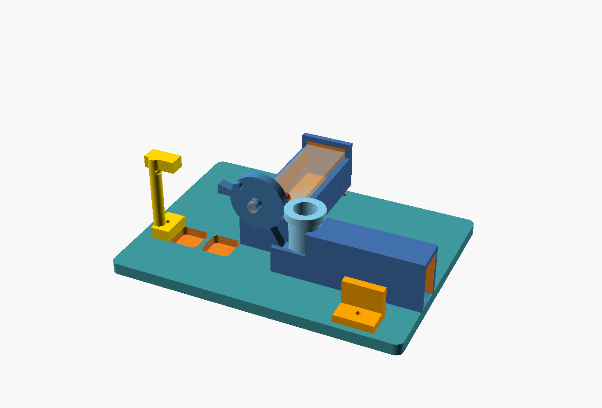
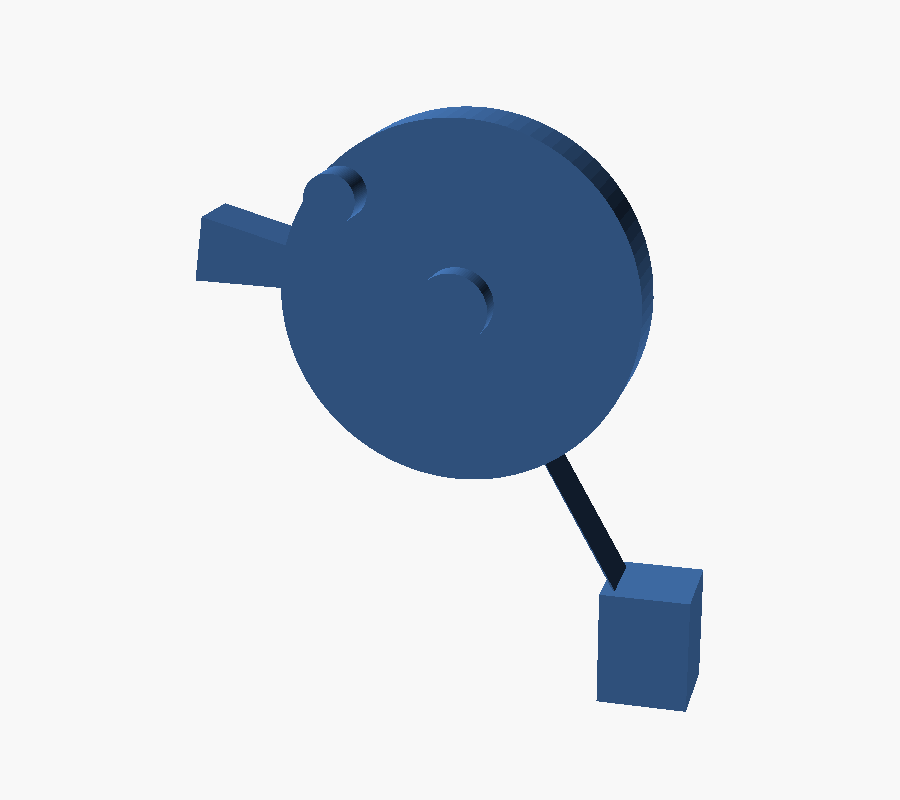
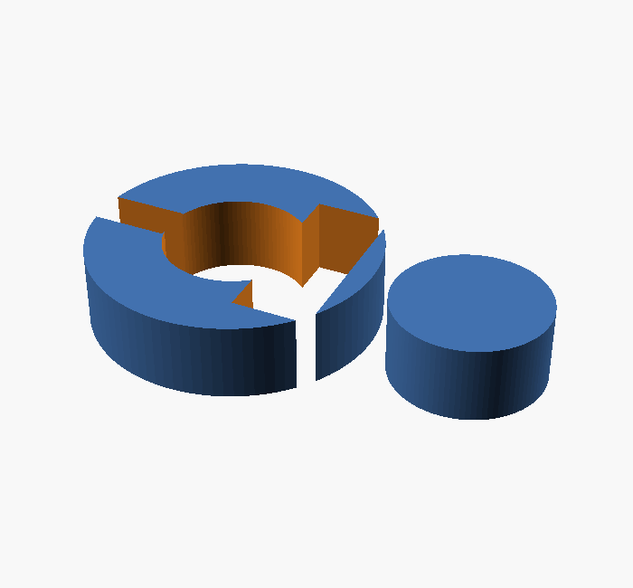

# 皮筋发射器（完全按卖家结构）

按卖家实物照片一比一还原的机构。核心就三样东西，不多加任何零件。

配套 issue #63。

## 卖家结构的全部要素

| # | 要素 | 说明 |
|---|---|---|
| ① | 成品 TT 减速电机 | 黄盒，130 电机 + 1:48 塑料齿轮箱，一体成品 |
| ② | 电机轴直接穿过圆板中心 | **同轴**，不是偏心曲柄 |
| ③ | 轴上装一个销子 | 跟着轴转，是主动件 |
| ④ | 圆板背面有凸台 | 被销子顶住 → 圆板被推着转、皮筋拉伸 |
| ⑤ | 销子转到凸台末端滑出去 | 脱扣靠几何自然发生，无棘爪无电磁铁 |
| ⑥ | 圆板前端有打击臂 | 皮筋把圆板拽回时，打击臂扫过弹丸 |
| ⑦ | 皮筋一端挂圆板、一端挂锚柱 | 储能元件 |

**唯一新增**：弹仓（原版手填弹）。这是为了实现连发，issue #63 的目的。

## 之前做错的地方（都删了）

| 错误的做法 | 正确做法 |
|---|---|
| 自制两级齿轮 1:25 | TT 电机自带 1:48 |
| 额外做曲柄盘 + 柱子 | 就用电机轴本身 |
| 曲柄与圆板偏心 | **同轴**，轴直接穿过去 |
| 齿条 + 棘爪脱扣 | 销子从凸台边缘滑出 |
| 手动计算脱扣角 | 几何自然发生 |

## 机构循环

```
销子顶住凸台 → 圆板反转、皮筋拉伸（上弦）
        ↓
销子转到凸台末端 → 滑出去（脱扣）
        ↓
皮筋把圆板猛拽回（击发）
        ↓
打击臂扫过弹丸 → 弹丸进入筒体加速 → 出膛
        ↓
弹仓下一发落下 → 等销子转回来 → 下一发
```

## 尺寸推导

打击块静止时必须紧贴弹丸后表面：

```
弹丸中心 (88, 11.5)，半径 5.5 → 后表面 x = 82.5
打击块半宽 3.5 → 臂端（块心）x = 79
枢轴 (64, 38)
  → arm_r = √((79−64)² + (38−11.5)²) = 30.5
  → 臂角 60.5°（自 +X 向下）
```

## Y 向分层（关键）

电机轴沿 Y，三层错开：

| 件 | Y 范围 | 说明 |
|---|---|---|
| 圆板 | −22.5 ~ −17.5 | 最外侧，带凸台与打击臂 |
| 销子套 | −17.5 ~ −14.5 | 紧贴圆板背面 |
| 电机本体 | −11.5 ~ 58.5 | 与弹道（Y=−20±6.5）不重叠 |

轴从电机伸出 9 mm，正好穿过销子套与圆板。

## 零件清单（9 件）

| # | 零件 | 体积 (cm³) | 外形 (mm) |
|---|---|---|---|
| 1 | 底板 | 96.56 | 150 × 110 × 6 |
| 2 | TT 电机座 | 15.66 | 28 × 76 × 26 |
| 3 | 弹道筒 | 9.50 | 58 × 17.8 × 26 |
| 4 | 弹仓 | 4.68 | ⌀20.8 × 40 |
| 5 | 圆板（凸台+打击臂） | 3.84 | 39.5 × 11 × 45 |
| 6 | 皮筋锚柱 | 2.64 | 16 × 16 × 44 |
| 7 | 按钮座 | 1.83 | 20 × 14 × 16 |
| 8 | 前段导轨 | 1.21 | 18 × 17.8 × 14 |
| 9 | 销子套 | 0.25 | ⌀18.1 × 3 |

合计 **136.17 cm³**，PLA 20% 填充约 **91 g**。
9 件全部封闭流形 ✓

| 总装 | 圆板 | 销子套 |
|---|---|---|
|  |  |  |

## 另配标准件

| 件 | 规格 | 数量 |
|---|---|---|
| TT 减速电机 | 1:48，3~6V | 1 |
| 皮筋 | 硅胶圈 | 2~3 |
| 自攻螺钉 | M2.5 × 8 | 10 |
| 点触开关 | Ø12 | 1 |

## 生成

```sh
for p in base-plate motor-cradle striker-plate pin-collar front-rail barrel magazine band-anchor button-mount; do
  openscad --export-format binstl -o "$p.stl" "$p.scad"
done
python meshcheck.py
```

## 物理仿真

`demo-physics.html` + `planck.min.js`（Box2D 移植）—— 真正的刚体动力学，
不是关键帧。可用于验证销子能否脱扣、皮筋多强能击发。

打开 `demo-physics.html` 即可，可实时调电机扭矩与皮筋强度。

## 待验证

- **未打印、未装配、未实发**
- 销子与凸台的接触角需打样后微调（`post_r` / `lobe_r1`）
- TT 电机座按公开尺寸 70×22×18 建模，实物有公差需改 `motor_w` / `motor_h`
- 圆板中心孔 φ5.6，实际需按电机轴实测
- 皮筋根数与预紧未定
