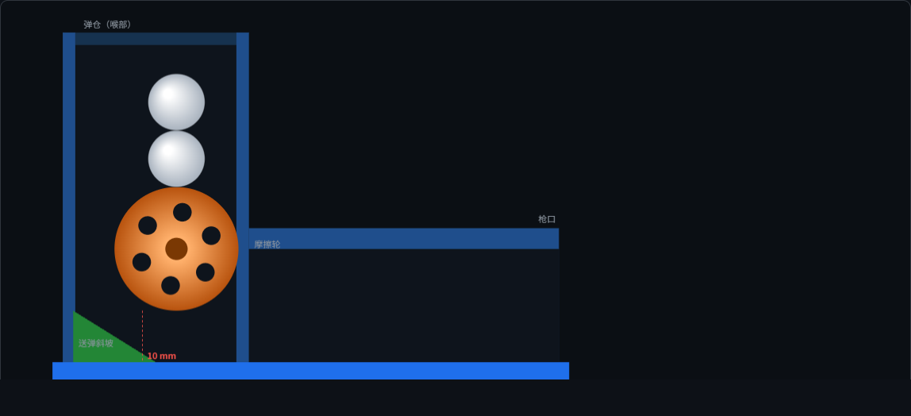

# 发射器机械件套件（全 3D 打印）

参考卖家 STEAM 摩擦轮发射器的结构，用 OpenSCAD 重新设计的一整套机械件。
原来的木质激光切割件与临时夹具，全部替换为可打印件。

配套 issue：#61「炮筒改良」

## 工作原理

```
                        ┌──────────┐
                        │  投弹口  │  ← 敞口，直接塞弹丸
                   ┌────┤   ○     ├────┐
                   │    │   ○     │    │   ← 弹丸一列叠在轮顶
                   │    │  (轮)   │    │       喉部 ≡ 弹仓
   ┌───────────────┴────┴──╳─────┴────┴───────────────┐
   │  底板    斜坡 ╱      10mm 咬口                    │→ 弹道筒向前延伸
   └───────────────────────────────────────────────────┘
        轮缘把最底下一发沿轮面下拖 → 挤过咬口 → 甩向 +X 出膛
```

- **电机轴沿 Y 横穿**，摩擦轮装在轴上、悬在弹道正上方
- **弹仓就是喉部**：单轮从上方压弹，储弹腔必须在轮正上方，否则弹丸落到轮边上就进不了咬口
- **弹丸一列叠在轮顶**，轮转动时把最底下一发沿轮面往下拖，压过轮下 10 mm 的缝
  （弹丸 11 mm，纸团可压缩），挤压加速后甩出
- **送弹斜坡**：咬口前的引导面，保证弹丸不会停在轮前的死点
- 全程没有弹簧、没有推杆，只靠轮缘摩擦与重力

> 喉部高度取 64 mm 是为了在轮顶之上留出至少 2 发的储弹空间。
> 早期版本取 44 mm，轮顶到喉顶只有 10 mm，连一发都放不下——这是做动画时才发现的。

## 零件清单（BOM）

| # | 零件 | 文件 | 体积 | 外形 mm | 作用 |
|---|---|---|---|---|---|
| 1 | 底板 | `base-plate.scad` | 31.12 cm³ | 100 × 65 × 16 | 承载全部零件，含送弹斜坡 |
| 2 | 弹道筒 | `barrel.scad` | 23.63 cm³ | 96 × 17.8 × 64 | 喉部兼弹仓 + 封闭弹道 |
| 3 | 摩擦轮 | `flywheel.scad` | 3.10 cm³ | ⌀24 × 12 | 摩擦驱动，轮缘带环槽 |
| 4 | 驱动支架 | `drive-bracket.scad` | 13.95 cm³ | 34 × 24 × 37.2 | 固定电机 + 支撑轮轴 |
| 5 | 按钮座 | `button-mount.scad` | 1.97 cm³ | 22 × 16 × 16 | 固定 Ø12 点触开关 |
| | **合计** | | **73.76 cm³** | | PLA 20% 填充约 **50.3 g** |

全部零件网格校验：**封闭流形 ✓**（每条边恰好被两个面共享）。

## 需要另配的标准件

| 件 | 规格 | 数量 |
|---|---|---|
| 直流电机 | 130 型，Ø24.4 × 38 mm，轴 Ø2 | 1 |
| 钢轴 | Ø4 mm × 60 mm | 1 |
| 联轴器 | Ø2 → Ø4 | 1 |
| 自攻螺钉 | M2.5 × 8 | 8 |
| 点触开关 | Ø12 mm 圆形 | 1 |

## 打印

| 零件 | 方向 | 支撑 |
|---|---|---|
| 底板 | 平放，斜坡朝上 | 无 |
| 弹道筒 | 开口朝下，喉部朝上 | 无 |
| 摩擦轮 | 平放，轴孔立起 | 无 |
| 驱动支架 | 立板贴床 | 需少量（电机筒悬空侧） |
| 按钮座 | 平放 | 无 |

建议 0.2 mm 层高、3 层壁、20–30% 填充。摩擦轮与支架建议 4 层壁提高强度。

## 生成 STL

```sh
openscad --export-format binstl -o base-plate.stl base-plate.scad
openscad --export-format binstl -o barrel.stl     barrel.scad
openscad --export-format binstl -o flywheel.stl   flywheel.scad
openscad --export-format binstl -o drive-bracket.stl drive-bracket.scad
openscad --export-format binstl -o button-mount.scad.stl button-mount.scad
```

总装预览：

```sh
openscad -o assembly.png --viewall --autocenter --imgsize=1200,900 assembly.scad
```

STL 不入库（`.gitignore` 忽略 `*.stl`）。

## 文件结构

```
launcher-kit/
├── params.scad            ← 全局参数，改这里整体联动
├── parts.scad             ← 全部零件模块库（不含几何体）
├── base-plate.scad        ┐
├── barrel.scad            │
├── flywheel.scad          ├─ 各零件独立渲染入口
├── drive-bracket.scad     │
├── button-mount.scad      ┘
├── assembly.scad          ← 总装
├── assembly-section.scad  ← 剖视总装
├── animation.html         ← 工作原理交互动画（单文件，双击即看）
├── meshcheck.py           ← 导出后的网格校验
└── preview/               ← 渲染图
```

## 工作原理动画

`animation.html` 是零依赖单文件网页，直接双击用浏览器打开即可。



- **发射**：`空格` 或点「发射」；**重置**：`R`
- 可调慢放倍率，实时显示轮速、出膛速度、余弹数
- 画的是 X-Z 剖视，颜色对应上方零件表

动画里的运动学是简化模型（匀加速近似），只用于说明机构关系，
不能当作弹道计算。但它能暴露装配层面的硬伤——比如喉部高度不足，
就是做动画时发现弹丸在轮上方放不下才改的。

## 待验证

- **未做实体打印与实弹测试**
- `ball_d`（弹丸直径）按 11 mm 估；纸团压实程度直接影响咬合，需实测
- `fw_squeeze`（压入量 1 mm）与斜坡高度可能需要按弹丸软硬微调
- 电机实际外形若与 130 型不符，改 `motor_d` / `motor_clamp_l`
