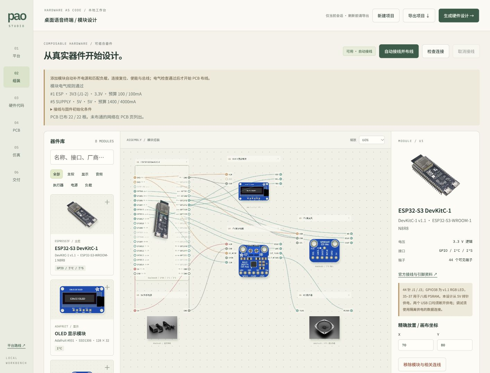
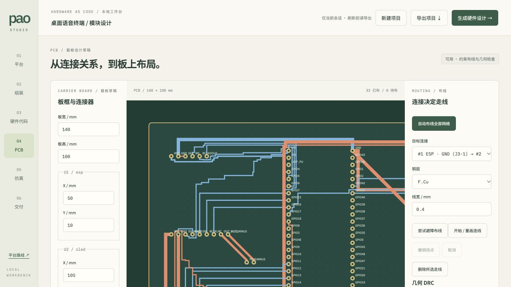
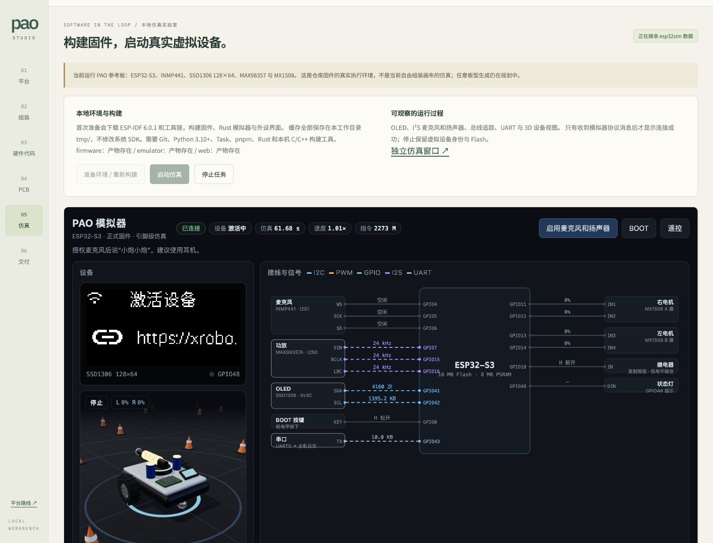

# PAO Studio

把硬件做成模块，把嵌入式开发带入软件工程工作流。

面向独立开发者和小型硬件团队的 React / TypeScript 本地工作台。组合真实器件、逐针接线、用 tscircuit 生成模块接口原理图，并在工作台管理 esp32sim PAO 运行时。平台方向见 [Issue #29](https://github.com/pao-1024/pao/issues/29)。



## 启动

需要 Node.js 24+、pnpm 10.32.1 与 Task v3。从仓库根目录执行：

```sh
task platform:dev
```

访问 <http://127.0.0.1:4173/>。项目只保留在当前页面会话，刷新前导出 JSON；当前没有导入或云端保存。端口被占用时启动失败，不自动切换端口。

生产构建与本地预览（含运行时管理 API）：

```sh
task platform:setup
task platform:check
task platform:build
pnpm --dir platform run preview
```

构建产物在 `tmp/platform-dist/`。检查入口与 Platform CI 一致：`pnpm run check` 执行类型检查、连接与 PCB 几何回归、真实 tscircuit 生成；`pnpm run build` 执行类型检查与 Vite 构建。tscircuit 引擎在用户点击生成时由独立 Worker 加载，不阻塞编辑器主线程；初次生成需要加载较大的引擎资源。

## 器件与组装

内置 ESP32-S3-DevKitC-1 v1.1（N8R8）、Adafruit SSD1306 六针 128×32 OLED、SPH0645、MAX98357A、DRV8833，以及 5V/4A 电源与 DC 转接端子、4Ω/3W 扬声器和 Pololu #992 电机。官方图片、资料与许可见[来源说明](public/modules/SOURCES.md)。

- 按厂商、型号、接口搜索，按类别筛选；点击器件或拖入画布添加，最多 20 个模块。
- 拖动器件标题移动，或在属性面板用 X/Y 坐标精确放置；缩放后移动坐标仍对应画布空间。
- 添加器件即补齐电源和匹配负载，按模块电气规则接线；“自动接线并布线”可重新执行。已有人工连接保留并重新校验；合规人工铜线固定，自动铜线重新规划。支持单 ESP32、每类一个有源外设和两台电机；接口分配不明确时提示错误。
- 手动接线作为调整入口：点击起点端子，再点击终点。Esc 或“取消接线”取消。点击线路查看两端；接线表逐根移除或导出 CSV。
- ESP32 保留 44 个 J1/J3 具名引脚；端子面板是逻辑引出，不表示图像的实物针序、比例或封装。
- 重复连接、自连接、保留脚、电源短接或并联、过压、过电流预算、时钟/数据/复位角色混接、桥臂输出短接、差分负载接地均被拒绝。校验已有接线时同样执行这些规则。
- 删除模块或连线时，相关 PCB 走线同时删除。

默认语音终端为 6 个模块、22 根连接，包含电源、扬声器与 OLED 复位。添加 DRV8833 后自动补齐两台电机，形成 9 个模块、33 根连接；参考布局按 ESP32 引脚侧分配连接器，两套方案均可完整自动布线。缺电源、公共地、负载、复位或使能时，暂停自动 PCB 布线和原理图生成，不能仅凭“端子已连接”通过检查。

## 模块电气规则

- 5V/4A 外部电源经 Adafruit #368 中心正极 DC 转接端子供电，主控、功放和电机驱动分别引出电源与地回线。ESP32 采用 5V 排针供电；两个 USB 口均须断开供电，禁止混用供电方式。
- 主控 5V 输入预留 600mA（含本体 500mA 与对外 3.3V 100mA 的项目额度）。OLED、麦克风分别按 90mA、10mA 预留；这是保守设计额度，并非实测峰值或稳压器额定极限。功放从外部 5V 取电，预留 800mA，不从 ESP32 的 3.3V 输出取电。
- 六针旧版 OLED 的 RST 接 GPIO17；驱动须在供电稳定后拉低 1ms，再拉高并初始化。其板载 I²C 接口上拉至 VIN，因此直连 ESP32 时 VIN 取 3.3V。5V VIN 与 ESP32 GPIO 的组合无论以何种顺序连接都会报错。GPIO38 为 v1.1 板载 RGB LED，35–37 用于该型号 PSRAM，启动与 USB/UART 保留脚均禁止分配。
- SPH0645 SEL 可接地或 3.3V，分别选择左/右声道；默认接地。MAX98357A SD_MODE 接 3.3V 选择左声道，GAIN 接地为 12dB；两端只接同一台 4Ω/3W 扬声器，检查阻抗和额定功率，禁止任一输出接地。
- DRV8833 VMOTOR 接外部 5V，SLP 接 GPIO18。固件必须保持 SLP 低，先将四路控制脚置低，再使能。两台 Pololu #992 分别接 A/B 输出；每台按 6V 下 360mA 理论堵转电流预留，在本方案 5V 下使用，低于驱动板默认每通道 1A 限流。堵转值用于启动电流预算，不表示允许持续堵转。FLT 未使用；需要使用时须先建模外部上拉。

页面展示逐路电流预算：语音方案 5V 为 1400/4000mA，增加电机后为 2120/4000mA；对外 3.3V 为 100/100mA。GPIO 角色、复位/使能初始电平及 I²S 48kHz / 32位双槽（BCLK 3.072MHz）参数随项目 JSON 导出，也可在固件页单独导出 `electrical-contract.json`。实际驱动必须按导出配置实现初始化；这些静态规则不等于已运行该组合的固件。

厂商具体型号不等于 PAO 原板型：SPH0645 不是 INMP441，DRV8833 不是 MX1508，六针 128×32 OLED 不是 PAO 四针 128×64 OLED。不得将官方外观替换误认为驱动与仿真模型兼容。

## tscircuit 硬件生成

硬件代码页从当前模块和连接生成可下载的 TSX。点击“生成原理图”实际调用 `@tscircuit/core`，输出 Circuit JSON 和原理图 SVG；连接或模块变化后旧生成结果失效。错误直接展示，超过 60 秒终止本次生成。

器件用具名端子的 `chip` 表达外部接口，不展开内部电路，PCB 生成关闭。固件页只编辑草稿，不编译、不自动修改 GPIO，也不会下发给模拟器。不会执行用户输入的任意 TSX。

## PCB 载板草稿



载板与接线共享端点数据，电气规则通过后在 Worker 中自动布线，编辑器保持可操作。修改接线或 PCB 布局会终止旧任务并重新规划；拖动组装外观位置不会重算 PCB。最多 45 秒停止本次任务，保留具体失败信息。合规人工铜线固定，自动铜线最多进行三轮失败网络优先重排。未布通网络单独列出，可调整板框或连接器坐标后重新规划，支持 JSON 与布局 SVG 导出。

ESP32 排针纵向间距 2.54mm、两排中心距 22.86mm，依据乐鑫 v1.1 尺寸图。其余模块以 2.54mm 外接连接器表示，并非模块安装封装。信号/配置支线至少 0.4mm、3.3V 电源 0.5mm、负载 0.8mm、5V/地母线 1.2mm；这是按 1oz 外层铜设置的项目布线目标，不构成温升或载流认证。铜间距 0.25mm，铜到板边 0.5mm，拒绝异网焊盘和同层交叉。短路径失败后使用受限 A* 搜索（每层最多 90,000 个网格点、15,000 次展开），不保证任意布局布通。无过孔、完整制造 DRC 或 Gerber；制造前仍须验证连接器、回流路径、温升、去耦与实际波形。

## esp32sim 真实运行时



仿真页通过 Vite 本地运行时管理器准备、启动、轮询和停止仓库原生 PAO 模拟器，保留其 OLED、音频、GPIO/I2C/MCPWM/I2S 观测及 UART 日志。页面只在收到真实 esp32sim 协议消息后显示连接成功；构建和运行日志可在页面查看。

也可以在页面点击“准备环境 / 重新构建”，SDK、工具链、固件、Rust 模拟器和模拟器网页会安装或构建到本 worktree 的 `tmp/`。命令行入口仍为：

```sh
task simulator:prepare
task simulator:run
```

首次准备需要联网下载 ESP-IDF 6.0.1 和工具链，也需要本机有 Git、Python 3.10+、Task、pnpm、Rust 和 C/C++ 构建工具。运行时身份与 Flash 仍由现有启动器管理，停止会发送中断让模拟器保存状态；8080/8081 被其他服务占用时不会接管或终止它。

构建后点击“启动仿真”。新虚拟设备的云端语音交互需要按固件提示绑定灵矽；本地外设观测不依赖绑定。麦克风需用户主动授权，浏览器限制内嵌页面时使用“独立仿真窗口”。本地 API 拒绝外站发起的控制请求，只允许 `127.0.0.1` 工作台同源调用，不应暴露到公网；单独托管 `platform-dist` 静态文件不提供运行时管理服务。

当前运行的是固定 PAO 参考板型。画布修改不会下发给该模拟器，也不能把其日志当作当前自由组合项目已通过验证。固件执行与硬件观测是真实的；小车运动模型不代表精确实物动力学。

## 能力状态

- 已实现：官方器件资料、可组合接线、真实 tscircuit 原理图生成、约束布线与几何检查、导出，以及 PAO 仿真环境准备、构建、启停和观测。
- 尚未打通：自由组合设计到固件驱动、动态板型和 esp32sim 模型的配置链路。
- 规划中：Agent 需求分析与软硬件协同生成、软件在环（SIL）回归、硬件在环（HIL）、核实封装与制造检查、打样交付。

平台价值是减少实物等待、配置不一致与可提前发现的打板返工。仿真不替代电气、射频、声学、功耗与实物验证，不承诺百分百还原所有硬件。

交互布局参考 <https://learn-arduino-red.vercel.app/zh/>；采用器件居中、具名端子、官方资料旁置的工作台结构，不复制参考站素材或源码。
